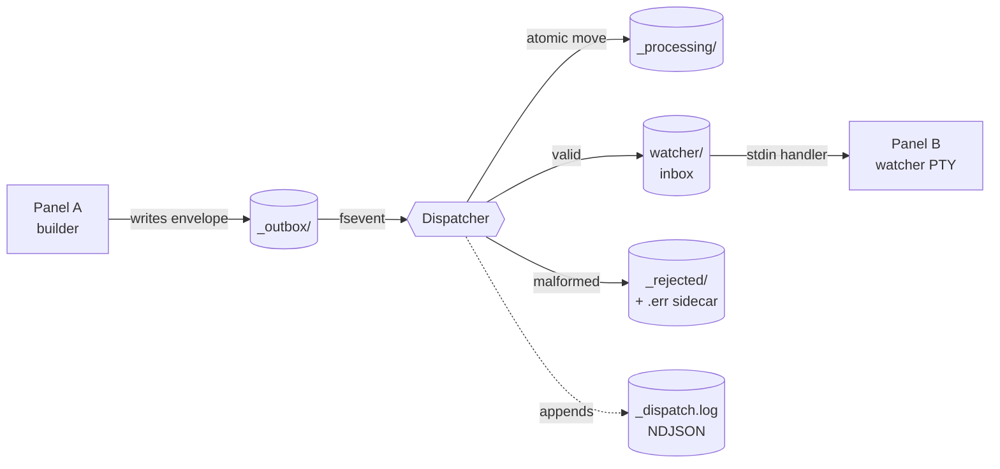
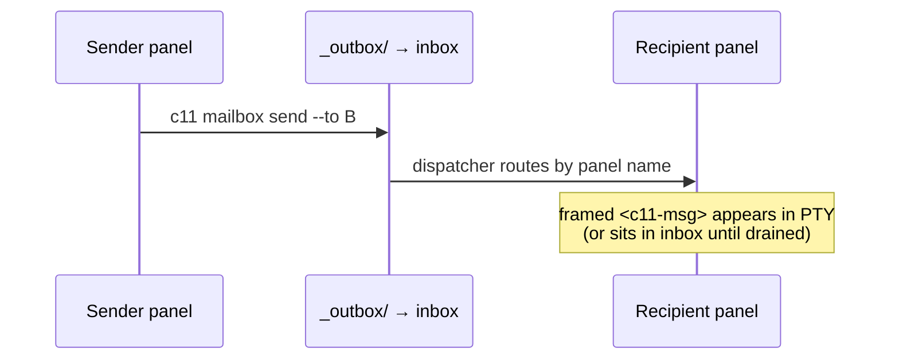
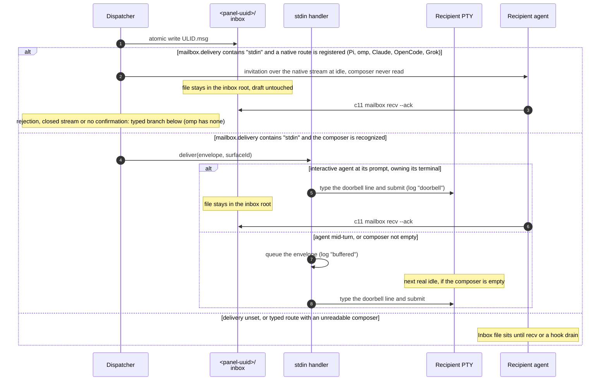
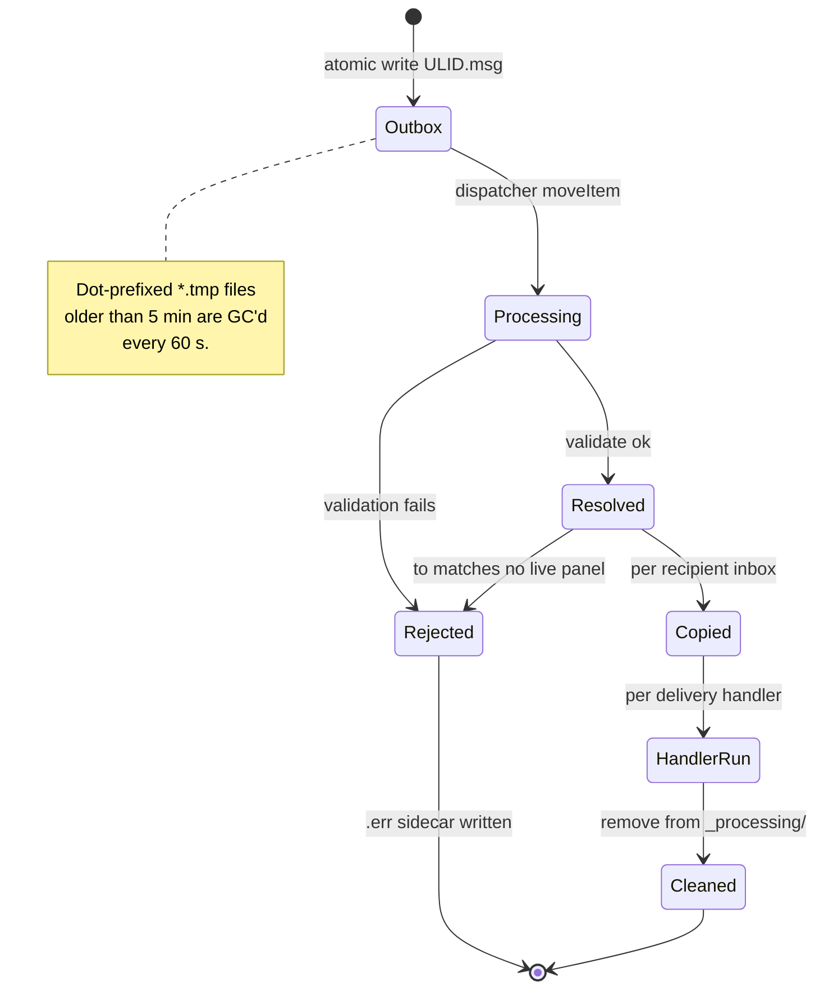
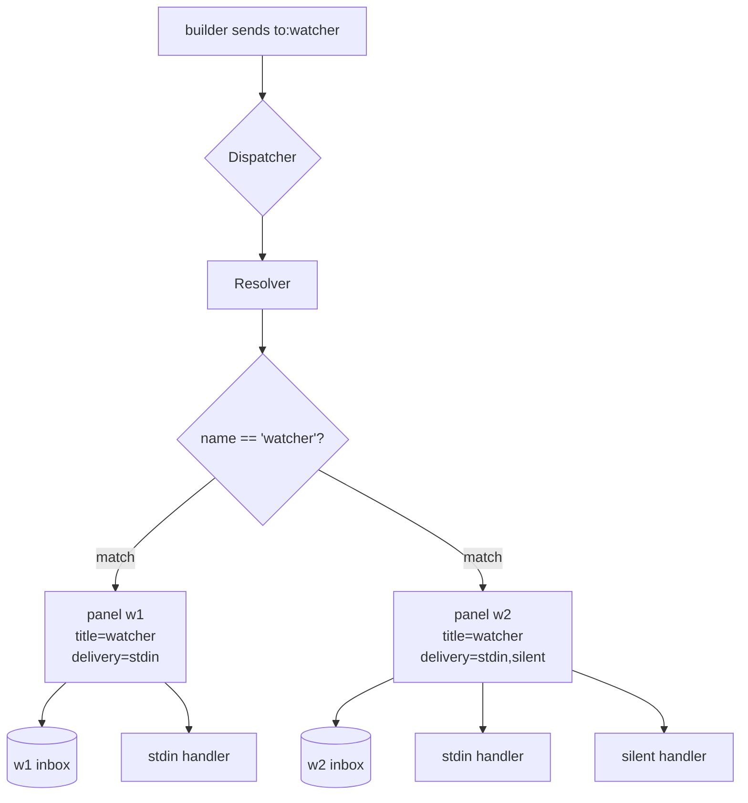
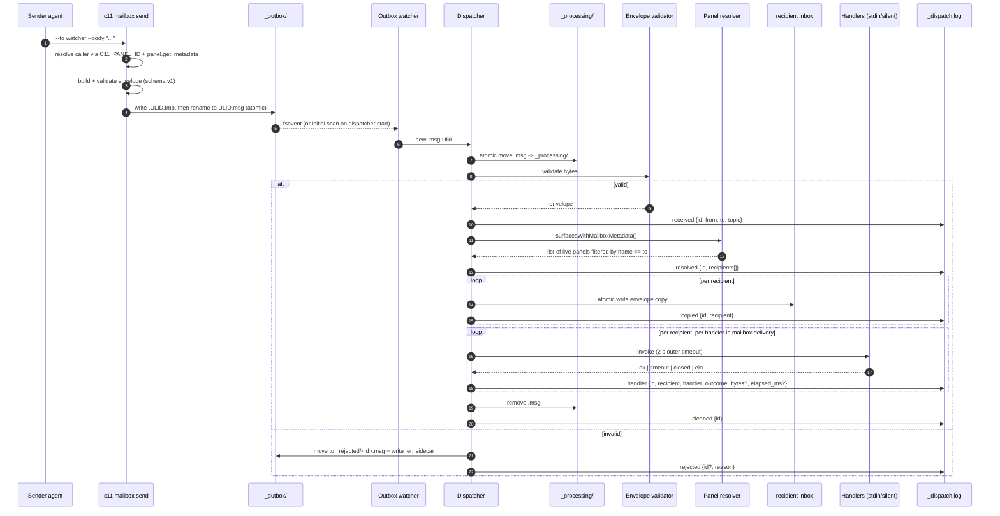

# c11 Mailbox: Agent-to-Agent Messaging Guide

The c11 mailbox is the in-workspace message board agents use to coordinate. One agent writes a small JSON envelope to a shared outbox; the dispatcher resolves the recipient by stable address, role, or title, drops a copy into the recipient panel's UUID-keyed inbox, and (when configured) injects a framed `<c11-msg>` block straight into the recipient's PTY.

Mailbox traffic is the durable coordination channel: the envelope and body remain recorded for later inspection. `c11 send` is a separate, direct PTY poke for a nudge or brief. Use mailbox messages for requests, handoffs, completion reports, and recoverable blockers; use a poke when the recipient simply needs to see an instruction in its working panel.

This is the practical guide. For the agent-facing quick-reference see the "Inter-agent messaging (mailbox)" section of `skills/c11/SKILL.md`. For the architectural rationale and v1 design discussion see `docs/c11-messaging-primitive-design.md`. For the wire schema see `spec/mailbox-envelope.v1.schema.json`.

> **Stage 2 status.** Everything in this document describes what ships today. Topic fan-out, the `watch` handler, `_processing/` crash recovery, and per-panel inbox caps are deferred to Stage 3 and called out explicitly where they would otherwise mislead you.

---

## What it is

A per-workspace tree under `~/Library/Application Support/c11/workspaces/<workspace-uuid>/mailboxes/` that holds the outbox, per-recipient inboxes, an append-only dispatch log, and quarantine/processing scratch areas. The c11 process running the workspace owns one `MailboxDispatcher` that watches the outbox and routes whatever shows up.

Recipients can live in **any** workspace, not just the sender's. `c11 mailbox send` resolves the recipient name across every live workspace in the instance and writes the envelope into the recipient workspace's own outbox, so that workspace's dispatcher delivers it locally (see [Cross-workspace routing](#cross-workspace-routing)).



Two facts to internalize:

1. **The filesystem is the contract.** The CLI is convenience over file I/O. Any process that can write a JSON file to a directory can send a message; any process that can list a directory can receive one.
2. **A panel is addressed by a stable handle, falling back to its name.** The resolver matches `to` with precedence **address → role → title** (see [Addressing](#addressing-stable-handles-and-the-title-fallback) below). A panel needs a title for bare-name addressing; the optional `mailbox.address` / `mailbox.role` keys give it a rename-proof handle, and `id:<uuid>` reaches an untitled panel by its exact UUID.

---

## Two channels: poke versus durable message

Choose the channel by whether the communication needs a record:

| Need | Command | Contract |
|---|---|---|
| Nudge, short brief, or immediate instruction in a panel | `c11 send --workspace <ref> --panel <ref> "…"` | Types into the target PTY and submits one turn. c11 records the full text as `panel.input_sent`, but the PTY action is not a durable completion receipt. |
| Request, handoff, completion report, or recoverable blocker | `c11 mailbox send --to <address> "<text>"` or `--body "<text>"` | Records the envelope and body. One trailing argument is the body when `--body` is absent, the same shape as `c11 send`. An empty body with no `--body-ref` is an error, and so is an unknown flag or a second trailing argument; nothing is sent. `mailbox.accepted` and `mailbox.delivered` events make the exchange inspectable. A drain or `recv` that claims the envelope records `via: drain`. The doorbell ring does not. A waiting agent that opted into push (`mailbox.delivery=stdin`) gets the doorbell line as a new turn when its composer is one c11 recognizes; a busy agent gets that line at its next idle. A harness c11 cannot recognize leaves the mail in the inbox. |
| Review the recorded exchange | `c11 messages view` or `c11 mailbox view` | Opens the live traffic page in a c11 browser panel without taking focus. The mailbox spelling is an alias. |

Declare `mailbox.address` once during orientation, before peers need to reach the panel. The address is stable across title changes, so it is the right value to use with `--to`; a title is display text and can change.

If the panel is an interactive agent and should receive pushed mail, opt in during orientation:

```bash
c11 set-metadata --panel "$C11_PANEL_ID" --key mailbox.delivery --value stdin --type string
```

c11 pushes only to an interactive agent that owns its terminal: the panel must pass the foreground-process and raw-mode checks. Plain shells, one-shot commands, and other programs never have mail typed into them; the mail still lands in the inbox. A waiting agent gets a new turn; a busy agent gets the mail at its turn boundary. Mail that cannot be pushed stays in the inbox. Claude's Stop hook (`Resources/bin/claude`) drains at turn end; no other wrapper installs a drain hook, so every other seat reads mail with `c11 mailbox recv --ack` after the doorbell line. `c11 mailbox recv --drain` is the explicit inbox floor.

A direct `c11 send` is refused (nonzero exit, nothing typed) when the target shows a recognized operator draft or question/plan dialog. A refused send exits nonzero and types nothing: do not press Enter afterwards, and if the operator is mid-draft raise a flag (`c11 raise-flag`) instead of retrying. `send` submits its own Return, so it rarely needs a `send-key enter` after it; when you chain one, write `c11 send --panel <t> "…" && c11 send-key --panel <t> enter` so a refusal stops the chain. Do not use a direct `c11 send` as the only completion or blocker report. Send the durable report through the mailbox, then use a direct poke only when the recipient also needs an immediate visible nudge.

---

## When to reach for it

Use the mailbox when:

- The operator asks you to coordinate with, hand off to, or notify another area ("tell the watcher area the build is green", "ask the reviewer agent to look at PR 73").
- A sibling agent needs to act and you are not the right panel to do the work.
- You want to leave a durable note for an area that may not be reading right now. The envelope sits in the recipient's inbox until they drain it.
- Two or more agents need to converge on a result and you want the exchange to be inspectable later (`_dispatch.log` is your audit trail).

Do **not** reach for the mailbox when:

- You and the recipient are the same panel. Just do the work.
- You need a tight request/response loop measured in milliseconds. The dispatcher is at-least-once, not low-latency.
- The payload is large. Inline `body` is capped at 4096 UTF-8 bytes; for anything bigger, use `body_ref` with an absolute path the recipient can read.
- You need fan-out by topic. Stage 2 does not deliver topic-only envelopes.

---

## Quick start

```bash
# In panel "builder":
c11 set-title "builder"
c11 mailbox send --to watcher "build green sha=abc"
c11 mailbox send --to watcher --body "build green sha=abc"   # same body

# In panel "watcher":
c11 set-title "watcher"
c11 set-metadata --key mailbox.delivery --value stdin --type string   # opt in to the doorbell
# The invitation starts a turn when the agent is idle; it never includes
# the envelope body. Pi, omp, Claude Code, OpenCode and Grok use their native
# route when available (see "Pi native delivery", "omp native delivery", "Claude
# Code native inbox", "OpenCode native plugin" and "Grok native leader" below).
# All but omp fall back to the typed route; omp has none.
c11 mailbox recv --drain                   # pull now, when stdout is a terminal
c11 mailbox recv --drain --ack             # a tool call or any other pipe: pass --ack
```

If `mailbox.delivery` is not set on the recipient, the envelope still lands in the recipient's inbox; the recipient drains it explicitly with `c11 mailbox recv`. With `stdin` set, push delivers to a waiting agent and to one whose turn ends; draining at turn boundaries stays the floor for everything push cannot reach.

## A panel's mailbox on its subtitle bar

Every panel that has received any mail shows a mailbox cell at the right end of its subtitle bar: `[unread] ✉ [received]`. Unread (orange) counts envelopes still in the panel's inbox root. A doorbell ring leaves the envelope there, so a rung message stays unread until `recv --ack` or a drain claims it into `_read/`. It sits on an orange backdrop for three minutes after the newest one lands, then stays plain orange. An orange number that does not go away means the agent is not taking its mail. Received (gray) counts the inbox root plus `_read/`. A panel that has never received mail has no cell, whether or not it declared an address; the cell appears when the first message lands and stays after the mail is read. A panel with mail and no description reads a dim "No subtitle set" in the bar until it sets one. While a draft holds delivery, the cell's tooltip and the drawer say how many messages are held behind that draft (`1 message held behind your draft`, or `3 messages held behind your draft`). A message whose ring already succeeded is not counted. Submitting the draft, or claiming the last unread message, clears the line. A question or an unreadable prompt does not show that line.

Clicking the cell opens a read-only drawer under the bar, with the panel sheet's motion and dismissal (Esc, a click outside, or the cell again). It lists the newest 200 messages, newest first: state, topic, sent time and age, the sender with its panel number and address when that panel is open, `in_reply_to` (a link when the parent is in the list), TTL and whether it expired, and the whole body. A `body_ref` file is read when it is an absolute path to a regular file, up to 64 KB, and a missing, unreadable or non-text file is named as such. Bodies render as plain text except for links: a `[Title](url)` or bare URL whose scheme is `c11`, `http` or `https` shows as a link (a titled link shows only its title). A plain click on a `c11://panel/<uuid>` or `c11://workspace/<uuid>` link lands exactly as a markdown-panel link does (selects the window and workspace, reveals and pulses the panel, records Back history) and closes the drawer; a closed or malformed target shows the non-modal notice over the drawer. `http` and `https` links open in the default browser. Every other scheme (`file:`, `smb:`, custom app schemes) stays plain text and opens nothing, and nothing else is styled: whitespace and line breaks are kept and the fold is unchanged. This holds in Received, Sent and the Insights message rows. Links are found once when the listing loads, not on every render; "Copy text" copies the raw body. Opening the drawer never claims, deletes or sends mail. Counts update when a copy lands (`mailbox.delivered` via `inbox`) and when a drain receipt is recorded (`via: drain`); both call `inboxChanged`. A doorbell ring does not. Cells on screen also recount every 60 seconds.

The drawer closes with the × at the right of its header or a second click on the envelope. It has a **Received | Sent | Conversations | Insights** switch; Received is the default. Insights shows exact totals (received, unread, taken, sent), activity by hour over the last 24 hours and by day over the last 14, top senders (with their unread), top topics, and who this panel sent to with how many of those copies were taken. Counts and activity cover every envelope; senders, topics and the urgent, reply, file-body and no-topic counts come from the newest 5000 (a note under them says so when the mailbox holds more), and sent figures from the `_sent/` ledger, which keeps the newest 300. It refreshes on every count change and every 30 seconds while open. Every sender, topic, chart bar and recipient is a filter: a click narrows the tiles, charts and rankings to that slice and lists its newest 50 messages (filters stack: a sender, a topic and one hour or day; a recipient shows what this panel sent there and whether each copy was taken). Clicking the same item or its chip clears it. Parsed headers are cached per file name for the life of the app, so only new mail is read on a refresh, and the drawer warms Insights in the background when it opens. The cell's counts are exact through 99999, then `123k`. Sent lists what this panel sent, newest first (at most 200): topic, sent time, each recipient with `UNREAD`, `READ` or `GONE` (its copy was swept or expired), and the body from a recipient's copy. It is built from two things the dispatcher writes when it accepts an envelope sent from a live panel in its workspace: the reserved `ext.c11_sender_panel_id` stamp on every recipient copy, and a small entry in the sender's own `<mailboxes>/<sender>/_sent/<id>.sent` (id, time, `to`, topic, the recipient panels and labels; never the body; the newest 300 are kept). Who sent is never guessed from `from`, which is only a name (another workspace's lookalike, or a panel whose address equals the sender's title, would match). `c11 mailbox send` attaches the exact calling panel and workspace as the reserved `ext.c11_sender_claim`; the dispatcher honors it only for a panel that is live in its own workspace, stamps that panel, and removes the claim so recipients never see it. No claim (raw writers, `--from` overrides, older CLIs), a claim from another workspace or for a closed panel, stamps nothing. A sender cannot supply the stamp: it is replaced or dropped on every envelope. The view lists only that `_sent/` directory, then looks at two paths per named recipient in the same workspace, and shows a copy only if it carries this panel's stamp, so it cannot reach mail the panel did not send. Mail sent before the stamp, without a CLI claim, or to another workspace, has no entry and does not appear in Sent (it still shows in Received). A panel that has sent mail but received none still gets the mailbox cell (counts at 0): the cell appears when its `_sent/` directory exists. While the Sent tab is open it refreshes every 5 seconds, because recipients claim mail without changing this panel's counts.

Conversations pairs this panel's mail by peer, both directions, in time order. Links in its bubbles open the same way as in Received. Its list has one row per peer, newest activity first: the peer's panel number and name, the time and first line of the last message with an arrow for its direction, whether this panel's last send to that peer was taken, is waiting or its copy is gone, and the peer's unread count. A closed panel's row is dimmed. A peer is a panel: received mail is keyed by its `ext.c11_sender_panel_id` stamp, and this panel's sends by the recipient panels in its `_sent/` entries. Mail without the stamp is keyed by its `from` in a separate row marked name only, and is never merged into a panel's conversation, because a name is not proof of a sender. A peer that moves to another workspace therefore splits: its earlier mail stays in its panel row, and what it sends from the other workspace arrives unstamped in a name-only row. A click opens the thread: oldest at the top, the peer on the left and this panel on the right, with day separators in local time. It opens at the first unread message, otherwise at the end. A received message is `UNREAD` or `TAKEN`. A sent one carries the state of the peer's copy, `WAITING`, `TAKEN` or `GONE`, and a broadcast appears in each recipient's thread with every recipient's state. A recipient whose panel is now in another workspace reads `GONE`, because the drawer looks only in this workspace's mailboxes. A reply links to its parent when the parent is in the thread; received files and ledger entries share the envelope id, so the link works in either direction. Long bodies fold behind Show all, a `body_ref` shows its path and size, and Copy text copies the whole text. A sent message's text comes only from a recipient copy that carries this panel's stamp, so a broadcast's text survives while any such copy remains; with none left the bubble keeps the topic, time and recipients and says the copy is gone. When the peer's side reaches back past the oldest `_sent/` entry, a dashed marker shows where this panel's sent record starts. The list reads the same cached headers as Insights (the newest 5000) and the ledger, and opens no body; only the open thread's newest 200 messages are read in full, with a line for any older ones. A received message shows in a thread only if the file, read in full, still carries that peer's stamp (or, unstamped, its name). When a panel holds more than 5000 received messages, Conversations covers only the time those reach back to: sends older than the oldest of them are left out too, so no thread shows one side alone, and a dashed marker at the top of each thread says where the scan stops. The drawer header counts every unread message, while the Conversations list counts unread only among the newest 5000 it reads. A drawer 500 points or wider shows the list and the thread side by side; a narrower one shows the list, then the thread with a back control. Esc closes the drawer from any tab; it cannot go back from a narrow thread, because the drawer panel never takes keyboard focus, so the back control does that. Both are the drawer's full height, so opening another thread never resizes it. Conversations is read-only like the rest of the drawer: opening a thread marks nothing taken. It refreshes on every count change and every 5 seconds while it shows.

A sender's name opens its conversation from the other tabs: the `from` name on a Received card, a sender name in an Insights message row, and a recipient on a Sent card. With a sender filter on, Insights offers **Open conversation** next to the chip, and a recipient filter does the same. The jump switches to Conversations with that thread open and placed as a click on its row places it, in a narrow drawer as in a wide one. The key follows the Conversations rule: stamped mail opens its sender panel's thread and unstamped mail its name-only row, and a name is never mapped to a panel. When several senders used one name (stamped panels, unstamped mail, or both), the chip says how many conversations there are and each message row opens its own. Every jump rescans the list at once and resolves only against a scan that started after the click, so the thread holds the very message that was clicked and opens at its first unread message. When that scan does not hold the conversation (past the 5000 received messages it reads), the thread pane says so, and no other peer's thread stands in for it.

Insights also shows **pickup wait**: how long received mail waited in this inbox before the agent took it. Every claim (`recv --ack` or a hook drain) appends a `claimed` row to the workspace's `mailboxes/_dispatch.log` with the claim time and the inbox's panel (C11-550). The wait runs from when the message landed (its file time, which the rename into `_read/` keeps; its name is no guide, because a hand-dropped file gets a ULID minted at the claim) to that row's time. Rows dated more than 5 minutes ahead are dropped. Only rows naming this panel count, so a broadcast's copies in other inboxes never mix in. The section shows the median, p90 and slowest wait, how many claims they cover (claims in the last 14 days), a five-step distribution (under 1 minute, 1 to 5 minutes, 5 to 30 minutes, 30 minutes to 2 hours, over 2 hours), and the median for the four senders with the most claims. It follows every received filter. The log is read off the main thread. The first look reads at most its last 8 MiB, and later looks read only what was appended since, from an offset cached per file. More than 8 MiB appended between looks, or a replaced or shortened file, starts over from the tail. A line longer than the tail is skipped to its end, never read as a row. At most 50,000 claims are kept per log, newest first. Notes say when the log was read back only partway through the window, when the log is missing or unreadable, how many messages taken in the window have no claim row (claims are recorded from c11 1.7.5), and when the mailbox holds more than the 5000 messages Insights reads.

## Live messages page

Open the local, self-contained view of both explicit `c11 send` traffic and mailbox traffic:

```bash
c11 messages view
# compatibility alias:
c11 mailbox view
```

c11 production writes the page to `~/Library/Application Support/c11/messages/messages.html`. A tagged or otherwise non-production bundle uses the same private directory with a bundle-keyed filename such as `messages-com.stage11.c11.debug.da8.html`, so it cannot overwrite the production page; XCTest hosts do not write a page. `messages view` opens or reuses a c11 browser panel for that file in the caller's workspace without stealing focus. The page reloads after a debounced event-log rebuild, and c11 rebuilds it from the retained event log and mailbox files when the app starts, so it remains useful across relaunches. It does not start a localhost server; the messages directory is mode `0700` and the page is mode `0600`.

The page has one timeline for both channels, a sender/recipient connection summary, per-mailbox lifecycle details, delivery health, and full message bodies. Search and filters cover workspace, agent, date, and channel. A queued send is shown as queued, a send is submitted only when its wire event says `submitted: true`, and an unknown `caller_title: null` is shown as an unknown caller (or its stable caller panel id). On rebuild, c11 supplements the current and rolled event logs with undrained inbox files, recipient `_read/` history, and root or nested `_rejected/` envelopes so older bodies survive log rotation. Agent-written fields are inserted as text in the browser page, the embedded JSON is protected against `</script>` breakout, and the page's CSP disallows network access.

---

## Addressing: stable handles and the title fallback

A `--to` value resolves against three per-panel keys, in precedence order:

| Precedence | Key | Set by | Notes |
|-----------|-----|--------|-------|
| 1 | `mailbox.address` | the panel, once at orientation | Stable, rename-proof handle. Survives every later `set-title` / `rename-panel`. |
| 2 | `mailbox.role` | the panel, opt-in | Reach a panel by function (`delegator`, `orchestrator`). Only `mailbox.role` is consulted — the canonical `role` key is not. |
| 3 | `title` | `set-title` / `rename-panel` | Display name. The fallback, so a bare-name send keeps working for panels that declare no stable identity. |

**Why this exists.** The title is mutable, and the c11 orientation convention has every agent rename its panel as its first action. If peers address each other by title, the bus silently re-partitions the moment anyone renames. Declaring a `mailbox.address` at orientation gives a panel an identity that does not move when its display name does.

```bash
# Recipient, once at orientation:
c11 set-metadata --panel "$C11_PANEL_ID" --key mailbox.address --value "delegator-c11-143" --type string
c11 set-metadata --panel "$C11_PANEL_ID" --key mailbox.role    --value "delegator"         --type string  # optional
```

**Bare name vs qualifier forms.** A bare `--to <x>` walks the precedence chain (address, then role, then title). To target a specific key unambiguously — never falling back to the title — use a qualifier form:

```bash
c11 mailbox send --to panel:delegator-c11-143 --body "…"   # matches mailbox.address ONLY
c11 mailbox send --to role:delegator            --body "…"   # matches mailbox.role ONLY
c11 mailbox send --to watcher                   --body "…"   # bare: address → role → title
c11 mailbox send --to id:00000000-0000-0000-0000-000000000011 --body "…" # exact panel UUID
c11 mailbox send --to-parent --body "done"      # this child panel's direct parent
```

These `panel:` / `role:` forms select *which panels* match; `id:<uuid>` matches one exact panel UUID and never falls back to a title. The workspace `--to-workspace` qualifier (below) is an orthogonal axis selecting *which workspace*. The envelope's `to` field stays an opaque string — no schema change — so the framed block a recipient sees carries whatever handle the sender used. `--to-parent` asks c11 for the caller's direct lineage parent and sends to its exact UUID; it requires `C11_PANEL_ID`, fails for a root or a closed parent, and never falls back to an ambiguous title.

`panel:`, `role:`, and `id:` (and the older panel qualifier prefixes) are **reserved leading tokens** in `--to`: a value beginning with one is always parsed as that qualifier, never as a title. So a panel whose title literally starts with one of these prefixes is not reachable by a bare `--to` (address it by its `mailbox.address`/`mailbox.role` instead). Any other colon stays part of a bare name — `--to ci:status` is a plain name.

**Back-compat.** A panel with only a `title` is addressable by that title exactly as before. `mailbox.address` / `mailbox.role` are additive. Whatever handle resolves the recipient, its inbox directory is keyed on the recipient panel's UUID (lowercased), never on the title, so a title with `/`, a 100-byte title, or a rename never breaks delivery.

---

## Send flow



Under the hood the dispatcher validates the envelope against schema v1, resolves the recipient by the address → role → title precedence (see [Addressing](#addressing-stable-handles-and-the-title-fallback)), copies into the recipient's inbox, and runs each registered delivery handler. Every state transition appends to `_dispatch.log` (NDJSON). Malformed envelopes land in `_rejected/` with a `.err` sidecar describing what failed. See [Internals: full send sequence](#internals-full-send-sequence) at the bottom for the complete step-by-step.

### Two equivalent send paths

Both must produce byte-identical JSON. The parity test enforces this.

**CLI (recommended for agents):**

```bash
c11 mailbox send --to watcher --body "build green sha=abc"
c11 mailbox send --to watcher --topic ci.status --urgent --body "CI red" \
  --reply-to builder --in-reply-to 01K3A2B7X8PQRTVWYZ0123456J
```

Auto-fills `version`, `id` (fresh ULID), `ts` (current UTC), and `from` (the caller's declared mailbox address, or `id:<panel-uuid>` when no address is set). Prints the new envelope id on stdout.

Send flags accepted by the CLI:

| Flag                  | Purpose                                                            |
|-----------------------|--------------------------------------------------------------------|
| `--to <panel>`      | Recipient handle, in any workspace. Bare name resolves address → role → title; `panel:<addr>` / `role:<name>` target one key. Required in Stage 2 (topic-only rejected). |
| `--to-workspace <ref>`| Disambiguate a name that exists in more than one workspace. A workspace UUID or `workspace:*` ref. |
| `--topic <token>`     | Dotted topic. Stored on the envelope; not used for routing yet.    |
| `--body <text>`       | Inline body, ≤ 4096 bytes UTF-8.                                   |
| `<text>`              | One trailing argument, used as the body when `--body` is absent.   |
| `--body-ref <path>`   | Absolute path to an external body. The inline body must be empty.  |
| `--reply-to <panel>`| Panel that should receive the reply.                             |
| `--in-reply-to <id>`  | ULID of the envelope being answered.                               |
| `--urgent`            | Sender hint. Handlers may honor or ignore.                         |
| `--ttl-seconds <n>`   | Advisory expiry. Recipients may drop expired envelopes on read.    |
| `--from <value>`    | Set the envelope's sender field explicitly.                       |
| `--id <ulid>`         | Pin envelope id (testing / replay).                                |
| `--ts <rfc3339>`      | Pin timestamp (testing / replay).                                  |
| `--content-type <m>`  | MIME hint for body or body_ref.                                    |

An empty body with no `--body-ref` is refused. `--body` together with a trailing argument, a second trailing argument, and any unknown flag are refused. The command exits nonzero and writes nothing. `--body` takes the next token as text even when it starts with dashes (`--body ---`, `--body --help`). `--` before a trailing argument does the same (`-- --literal`). `mailbox send --help` still prints help and sends nothing.

With no explicit `--from`, c11 uses the non-empty `mailbox.address` declared by the caller. Without a non-empty address, it writes `id:<panel-uuid>` so a reply still reaches that panel after a rename. `id:<uuid>` is an exact address accepted by `--to`. `c11 mailbox sender-from` prints the same default for raw-file writers; `panel-name` remains a title-only helper.

**Raw file write (any process, any language):**

```bash
OUTBOX=$(c11 mailbox outbox-dir)
MY_FROM=$(c11 mailbox sender-from)
ULID=$(c11 mailbox new-id)
cat > "$OUTBOX/.$ULID.tmp" <<EOF
{"version":1,"id":"$ULID","from":"$MY_FROM","to":"watcher","ts":"$(date -u +%FT%TZ)","body":"build green sha=abc"}
EOF
mv "$OUTBOX/.$ULID.tmp" "$OUTBOX/$ULID.msg"
```

The dispatcher only sees files that match `*.msg` and do not start with `.`. Always write to a dot-prefixed `.tmp` sibling first and rename. A canonical reference lives at `Resources/bin/c11-mailbox-send-bash-example.sh`.

> **Raw writers are workspace-local.** `outbox-dir` prints *your own* workspace's outbox, and a dispatcher only resolves names within its own workspace. So a raw file write reaches only recipients in your workspace. To deliver across workspaces, use `c11 mailbox send` (which resolves globally and routes for you) — or write into the recipient workspace's outbox directly. A raw envelope whose `to` matches nobody in that workspace is **rejected**, not silently dropped (see below).

---

## Cross-workspace routing

`c11 mailbox send` resolves `--to` against every live panel in the running c11 instance, then writes the envelope into the **recipient's** workspace outbox. The recipient workspace's own dispatcher picks it up and delivers locally — same machinery as a same-workspace send, just a different outbox. The `from` field still names the sender; the dispatch trail lands in the recipient workspace's `_dispatch.log`.

Resolution precedence is deterministic:

1. **Local-first.** If the name matches a panel in *your* workspace, it is delivered there — a same-workspace send never reaches into another workspace, even if a same-named panel exists elsewhere. Existing same-workspace behavior is unchanged.
2. Otherwise, among the other workspaces: exactly one match → delivered there; **more than one workspace** has the name → the send fails with an *ambiguous* error listing the candidate workspaces; no match anywhere → the send fails *unresolved* with a non-zero exit (the message is not written).

**Name collisions across workspaces** (two panels both named `Builder` in different workspaces) are resolved by qualifying with `--to-workspace <ref>`:

```bash
c11 mailbox send --to Builder --to-workspace workspace:4 --body "go"
```

Multiple same-named panels *within one* workspace still fan out to all of them (unchanged) — that case is unique, not ambiguous.

If the c11 socket is unreachable, `send` falls back to writing into your own workspace's outbox so same-workspace delivery still works offline; cross-workspace recipients then surface as a dispatcher *rejection* rather than a silent drop.

---

## Receive flow

There are two receive modes. Which one fires depends on the recipient's `mailbox.delivery` metadata.



The first branch is the native route, which never inspects the composer. The two branches after it are the typed route, including the fallback from a failed native attempt; they keep every composer check. Replay-capable OpenCode 2 is the exception: an ambiguous native result holds its exact envelope snapshot out of typed input until the same native attempt is replayed, for at most 60 seconds. If the plugin has not reconnected by then, the snapshot and any later mail go to the typed route with every composer check. OpenCode v1 keeps its existing typed fallback.

### Pi native delivery

Interactive Pi launched through c11's bundled wrapper registers an event-driven
`mailbox.native.subscribe` stream. When opted into `mailbox.delivery=stdin`, it
receives the same invitation through Pi's `sendUserMessage` API. It waits for the
idle edge; Pi 0.81.1's queued API returns no acceptance receipt while busy. The
extension confirms acceptance only when Pi emits the invitation's user
`message_start` event. It never reads, clears or types into the composer, so an
operator draft and the typing quiet window do not hold a native invitation.
Unread mail, opt-in, self-raised flags, `mailbox.doorbell=off`, covered envelope
IDs and the 20-attempt cap still apply. Native delivery never claims mail.

An absent extension uses the existing typed route. A rejected request, broken
stream or missing acknowledgement after two seconds passes the same envelopes
back through the typed turn, composer, quiet-window, coverage and rate checks.
Delivery is at least once: a late acknowledgement covers only the originally
dispatched IDs and logs `native_late_accept`. It can coincide with a typed
fallback. A new Pi session or connection revalidates process identity and can
ring still-unread mail again. No configuration is written under `~/.pi`.

The stream binds a panel UUID, live foreground agent PID and kernel start time,
and a per-session ID. Its request parameters are `panel_id`, `agent_pid`,
`session_id`, `route` and `can_queue`. The socket's kernel peer must be that
harness or a verified descendant. Sidecars may have no controlling terminal;
the harness must still own the panel's foreground terminal. The parent walk
checks process start times and revalidates its chain to reject PID reuse.
A claimed `agent_pid` or a matching caller terminal alone is insufficient.
The initial success returns
`subscription_id`; subsequent JSONL frames are `{type:"deliver", delivery_id,
text}` from c11 and `{type:"accepted"|"rejected", delivery_id}` from the consumer.
Only positive in-harness acceptance may produce `accepted`. Pi uses
`route:"pi_extension"`, omp `route:"omp_extension"`, Claude `route:"claude_inbox"`
and OpenCode `route:"opencode_plugin"`, all with `can_queue:false` (idle-only); `codex_queue` remains reserved. Authentication follows the existing socket
policy, and IO runs off the main thread. Established idle streams do not poll.
A new subscriber replaces the previous listener for that panel, including an
in-process listener replaced by a sidecar. The old stream receives
`{type:"replaced"}` before closing and stops reconnecting. An explicit
`ok:false` subscription reply also stops that subscriber, except for the
transient `not_ready` response during session restore, which retries. A new
harness session can try again after other refusals. Unexpected connection loss
still retries with bounded backoff.

`_dispatch.log` names `route:"pi_extension"`, `route:"omp_extension"`, `route:"claude_inbox"`, `route:"opencode_plugin"` or `route:"typed"` on each ring.
After a native failure, the typed entry also names `native_route` and
`native_failure` (`native_timeout`, `native_rejected`, `native_disconnected`,
`native_replaced`, `native_unavailable` or `native_write_failed`; the Claude
bridge's own reasons are listed under Claude Code native inbox). Replay-capable
OpenCode 2 holds ambiguous failures off typed delivery while it retries the
same attempt ID; legacy OpenCode v1 keeps the existing at-least-once typed
fallback. The failed attempt itself is a `doorbell_failed` row carrying the
same `native_*` reason,
and a late confirmation is a `doorbell` row with reason `native_late_accept`.
To compare the typed route diagnostically, launch Pi with
`C11_PI_NATIVE_MAIL_DISABLED=1`; with it set no native attempt is made and no
failure is logged. The wrapper's lifecycle observations remain active.
Route and native-failure metadata appear only on actual `doorbell` or
`doorbell_failed` attempts. Skipped and capped rows leave those fields absent.

For repeatable guest proof, stage `--agents pi` with `sandbox-up.sh`, then run
`scripts/check-pi-native-mail.py <run-id>`. Staging copies the host's Pi package
and standalone Bun runtime, plus a controlled provider fixture. It uses the
real Pi TUI and extension API, exports no credentials, and does not exercise a
real model provider. Install Pi 0.81.1 and Bun on the Tart host first.
`--agents pi-live` stages the same Pi against OpenRouter instead (one credential,
the OpenRouter key, from `C11_SANDBOX_OPENROUTER_KEY` in the caller's environment,
written in the guest as a mode 600 `auth.json`; set it again for `verify-clean`).
`scripts/check-live-native-mail.py <run-id> --kind pi` then runs one real-model
smoke of the native route with an unsent draft in the composer.

### omp native delivery

Interactive omp launched through the bundled wrapper loads a second launch-flag
extension, `omp-native-mail.ts`, beside its prompt cache bridge. It registers
`route:"omp_extension", can_queue:false` on the same stream as Pi and reports
`working`/`idle` through `agent-hook` (the wrapper exports
`C11_AGENT_INTERACTIVE_PID` for an interactive agent session). `agent_start`
publishes `working`. Idle is published after `agent_end` only once `isIdle()` is
true and no newer turn has begun (omp can start a continuation, such as an
empty-response retry, before it emits the old `agent_end`), and by `session_start`
and `session_switch` when the new context is idle. A new session (`/new`, a
resume) emits `session_switch`, which rebinds the stream with a fresh session ID.

The invitation goes in as a custom message, `sendMessage({customType:
"c11-mailbox-doorbell", content, display:true}, {triggerTurn:true})`. At idle omp
starts a turn and the model reads the invitation like a user message. Two other
omp calls were rejected on evidence: `sendUserMessage(text)` also starts a turn,
but omp's UI clears the composer for any user message it did not submit itself
(it would erase an operator draft), and with `deliverAs:"followUp"` it queues
even when idle and emits nothing until the queue drains, so there is no
acceptance signal inside c11's two-second bound. Mid-turn, `sendMessage` steers
into the running turn, so the route is idle-only: the consumer waits up to 1.5
seconds for `isIdle()` and otherwise rejects before any side effect. Mail that
arrives mid-turn waits for the idle edge, as in Pi. Acceptance is omp's own
`message_start` for that custom message with the exact doorbell text; the same
words as a user message, or another custom type, do not accept.

omp has no typed composer reader, so there is no typed fallback. A busy
`native_rejected` (made before any side effect, for mail that raced the start of
a turn) is retried natively at the next ring, bounded by the 20-per-10-minutes
cap. A hard failure (`native_timeout`, unavailable, replaced or disconnected)
leaves the mail in the inbox for `c11 mailbox recv --ack`. The failed IDs do
not retry indefinitely: while they stay unread the native route is withheld
for them, but a new unread envelope permits a fresh native attempt, and a later
failure suppresses the IDs from that attempt until more mail arrives. Claiming
the failed envelopes, or a new omp session, also restores the doorbell. Pi and
Claude keep their typed-fallback behavior. The extension
writes nothing: omp's own state, including `~/.omp`, is untouched. Task
subagents (`hasUI` false) neither subscribe nor report lifecycle. For diagnosis
launch with `C11_OMP_NATIVE_MAIL_DISABLED=1`: no native attempt is made, nothing
is logged as a failure, omp gets no doorbell at all, and lifecycle reports remain.

For repeatable guest proof, stage `--agents omp` with `sandbox-up.sh`, then run
`scripts/check-omp-native-mail.py <run-id>`. Staging builds one self-contained
omp install on the Tart host (`~/c11-omp-stage`, omp's version, Bun 1.3.14 or
newer) and ships it with a controlled provider fixture
(`scripts/fixtures/omp-mailbox-provider.ts`); the guest shim keeps omp's state in
a private HOME. It checks draft preservation before and after the turn, a draft
typed mid-turn, the idle edge, `/new`, the no-typed-route control, and that the
guest's own `~/.omp` was never created. `--disable-native-control` must fail the
native assertions. `--agents omp-live` plus
`scripts/check-live-native-mail.py <run-id> --kind omp` runs the same route
against OpenRouter's `openai/gpt-4o-mini`.

### Claude Code native inbox

The interactive c11 wrapper adds an async SessionStart hook to its existing per-launch settings file. When Claude exports a messaging socket and session token, the bundled bridge registers `claude_inbox` on `mailbox.native.subscribe`. It sends only the invitation, at idle, and confirms a new matching peer-message record in that same session's transcript within two seconds. It never types into or reads the composer, so an operator draft stays intact. The token stays in memory; no MCP configuration, channel flag, consent prompt, or tenant settings write is involved.

The native route keeps the unread, push opt-in, doorbell-off, self-raised flag, process ownership, coverage, and rate checks. It skips checks that protect typed input, including composer state and the operator quiet window. The envelope remains unread until `recv --ack` or the existing Stop hook claims it. A busy arrival still waits for the turn boundary, where the Stop hook may drain it first.

Missing hook support, a closed listener, or no positive confirmation uses the ordinary typed decision with all its input protections. Claude's explicit `crossSessionInbound` policy is respected; a successful socket write alone is not delivery. Dispatch records use `route: claude_inbox`; typed fallback records use `route: typed` and include `native_route` and `native_failure` after a failed native attempt.

If Claude holds an “unidentified session” message whose complete body is exactly `c11 mail waiting: run c11 mailbox recv --ack`, the operator can safely choose **Deliver**: the invitation only asks the agent to read its own c11 inbox. The typed fallback cannot clear that chooser. The mail remains queued until `c11 mailbox recv --ack` or the Stop hook claims it, whether or not the invitation is delivered.

An unconfirmed Claude native attempt records one `mailbox.native_unconfirmed` event and one `native_unconfirmed` row in the workspace's `_dispatch.log`, independent of the number of queued envelopes. Both carry `delivery_id`, `panel_id`, `claude_session_id`, `route` and `reason`. The reason is `unconfirmed` or `timeout`; `refused` is reserved for an explicit Claude bridge refusal, which the current bridge does not send. Claude's silent `hold` and `refuse` policy decisions cannot be distinguished from missing confirmation and remain `unconfirmed`. Older bridges that do not report the bound Claude session leave `claude_session_id` null; c11 never substitutes the registration epoch. Duplicate replies, the later timeout, and late acceptance do not add another diagnostic for the same attempt. The event counts misses of the first confirmation window, not lost mail: a later acceptance can still produce `native_late_accept`. It contains no token, message body, or transcript text and does not change delivery mode.

Read the event with `c11 events tail --filter type=mailbox.native_unconfirmed --since 1h`; `c11 mailbox tail` exposes the workspace log. Event recording follows the existing activity-history policy. The optional `claude_session_id` UUID on `mailbox.native.subscribe` is accepted only for `claude_inbox`; it supplies diagnostic identity and does not change the subscription's fresh `session_id` or delivery checks.

The bridge reports why an offer failed, and `native_failure` names it:

| `native_failure` | Meaning |
|---|---|
| `native_transcript_unavailable` | The session transcript could not be opened; nothing was sent. |
| `native_inbox_unavailable` | Claude's inbox socket could not be reached; nothing was sent. |
| `native_inbox_write_failed` | The invitation write stalled or broke partway. |
| `native_unconfirmed` | The write succeeded, but no matching record appeared within 1.8 seconds. `crossSessionInbound` `refuse` or `hold` lands here, because Claude accepts the write and answers nothing; so does a changed acceptance marker. |
| `native_timeout` | The bridge itself said nothing within two seconds. |

After `native_inbox_write_failed` or `native_unconfirmed`, the bridge keeps watching the transcript for 10 seconds. A confirmation in that window is logged as `native_late_accept` and covers the dispatched IDs. Delivery is at-least-once, so a duplicate invitation is possible.

`--resume` and `/clear` create a fresh subscription bound to that launch's session transcript. The bridge stays armed across repeated wakes and long idle, and exits when its Claude process exits or its c11 connection closes. If c11 restarts while Claude stays running, that session uses typed fallback until its next SessionStart. Print, background, and passthrough commands do not gain the bridge. Other MCP flags remain the operator's own. For a typed-route comparison, launch with `C11_CLAUDE_NATIVE_MAIL_DISABLED=1`; lifecycle and Stop-drain hooks remain active.

The hook's five-second timeout was observed as unenforced for async hooks; if Claude starts enforcing it, the route falls back to typed delivery.

For a repeatable Claude guest proof, stage `--agents claude` with `sandbox-up.sh`, then run `scripts/check-claude-native-mail.py <run-id>`. It uses real Claude sessions in isolated scratch configuration, checks native draft/repeat, `/clear`, `--resume`, hook-absent fallback, explicit inbound refusal, and unchanged default tenant files. `--disable-native-control` removes the bridge and must fail the native-with-draft assertion. The caller owns the guest and credential cleanup.

### Grok native leader

An interactive Grok launched by the c11 wrapper runs its agent in a private Grok leader: the wrapper adds Grok's own `--leader --leader-socket /tmp/c11-grok-leader-<pid>.sock`, with no Grok configuration written. Beside it, the wrapper starts `c11 grok-mailbox`, which keeps one ACP client (`grok agent --leader --leader-socket <path> stdio`) connected to that leader and registers `grok_leader` on `mailbox.native.subscribe` once the socket exists. At idle it sends the fixed invitation to the bound session with `session/prompt`, and accepts on the leader's echo of that text (the session's prompt queue or user row) within 1.8 seconds. The turn runs in the TUI like a typed one, Grok's permission prompts stay in the TUI, and the composer is never read or touched. `can_queue` is false.

Grok has no signal for which session its TUI shows, and a leader runs a prompt in any live session it holds. Before each offer the sidecar reads `$GROK_HOME/active_sessions.json` and refuses (`native_session_conflict`) unless that Grok process holds exactly the bound session. `/new`, `/resume` or a dashboard dispatch adds an entry, so that panel uses the typed doorbell, which types into whatever the TUI shows, until Grok relaunches. Other failures (`native_not_ready`, `native_unconfirmed`, `native_timeout`, a closed stream) also fall back to typed delivery; a confirmation within 10 seconds of an unconfirmed offer logs `native_late_accept`.

The wrapper skips leader mode when the operator passes `--leader`, `--no-leader`, `--leader-socket` or `--sandbox`, sets `GROK_SANDBOX`, launches non-interactively, uses `--continue` (no bound session), or when the installed Grok rejects `--leader` (probed with `--leader --version`). Grok itself refuses leader mode under any sandbox profile and then creates no socket. The leader outlives its TUI, so the wrapper stops it when Grok exits: the PID in the lock beside the socket must hold that socket (`lsof`) before it is sent SIGTERM; it never runs `grok leader kill`, which stops every leader. Each launch also reaps `c11-grok-leader-*` leaders whose Grok is gone. For a typed-route comparison, launch with `C11_GROK_NATIVE_MAIL_DISABLED=1`.

### OpenCode plugin compatibility

The PATH wrapper checks the resolved OpenCode binary version before adding a c11 plugin. It supports the existing v1 plugin contract and OpenCode 2.0.25's client-side TUI plugin contract. Unknown versions receive no plugin injection and use the typed c11 route. No wrapper path writes OpenCode tenant configuration.

| Feature | OpenCode v1 | OpenCode 2.0.25 | Safe fallback |
|---|---|---|---|
| Exact displayed-root capture | v1 lifecycle plugin plus TUI bridge | Per-client `setup(context)` plugin reads the TUI route and loaded session row | No exact binding; unsupported DB remains unverifiable |
| Native mailbox | `c11-mailbox.mjs` TUI route; retains the two-second typed fallback | TUI plugin bound only after exact c11 capture; advertises stable-attempt replay | v1 keeps its documented at-least-once fallback; v2 retries the same attempt and holds its exact mail snapshot off typed fallback after an ambiguous result, for at most 60 seconds |
| Lifecycle and status | v1 server plugin | Per-client TUI plugin reports exact displayed-root execution edges through `agent-hook` | Child, sibling, former-route, and shutdown events do not change the panel |
| Prompt-cache telemetry | v1 server plugin | Unavailable in the v2 adapter | No server-side panel attribution |
| Permission notifications | v1 server plugin | Unavailable in the v2 adapter | OpenCode's permission behavior is unchanged |

For v2, the wrapper composes `OPENCODE_CLI_CONFIG_CONTENT` in memory with the effective ordered `cli.json` plugin list. Its JSONC reader accepts comments and trailing commas even when comments separate a comma from the closing brace or bracket. An environment `plugins` array takes precedence over the on-disk array, matching OpenCode's config merge; the c11 local package is appended without dropping string or `-id` directives. File-only settings stay in the file layer, so a later `cli.json` change is not shadowed by a copied environment snapshot; only the plugin array is deliberately overlaid. Malformed operator content or config disables injection and leaves the environment and file untouched. The v2 path does not set `OPENCODE_CONFIG_CONTENT`, `OPENCODE_CONFIG`, or `OPENCODE_TUI_CONFIG`. The TUI plugin runs in the individual client, never the shared server. The wrapper makes an authenticated pending-root claim before composing its config; malformed config leaves the route unbound and typed delivery held.

The v1 TUI adapter does not advertise `supports_attempt_replay`; it keeps its
existing two-second typed fallback and at-least-once semantics. OpenCode 2.0.25
sets that capability on its native subscription. For v2, a submitted prompt
keeps the stream from reconnecting until its durable result arrives. After an
ambiguous socket loss, c11 retries the same attempt ID and exact envelope
snapshot; it does not type those IDs while they may already be in the TUI.
Later mail receives a separate attempt. This capability gate preserves the v1
wire shape and fallback while limiting the no-duplicate replay contract to v2.

The hold lasts at most 60 seconds from the failure. The plugin reconnects as
soon as its own prompt result settles, with a backoff capped at 10 seconds, so a
working plugin replays well inside that bound and nothing is typed. If the TUI
stays up but its stream never returns, the operator sees nothing for up to 60
seconds and then the ordinary typed doorbell line, under every typed check: a
turn in progress, a draft, a question, the quiet window, flags, the rate cap
and the exact-root identity gate. `_dispatch.log` shows one
`doorbell_skipped` row with reason `native_attempt_unconfirmed`, a
`doorbell_recheck` row with reason `native_hold` and the delay to the typed
look, then the typed rows with `native_route` and `native_failure`. `mailbox
status` reports the wait as pending. If the attempt was admitted after all,
OpenCode runs that turn first, so the typed line can only arrive at an idle,
empty composer after it: at worst a second invitation, never a prompt typed
into a turn. The one residual is a prompt OpenCode admits more than 60 seconds
after c11 sent it, which c11 cannot see; it yields at most one extra
invitation. A plugin that reconnects after the typed line was submitted finds
the snapshot covered and does not replay it. A busy (`native_not_ready`) or
conflicting-route (`native_session_conflict`) refusal happens before any prompt
and keeps waiting for the plugin's own recovery.

Every interactive v2 wrapper launch records the OpenCode TUI PID and kernel process start time in c11; an explicit `-s`/`--session` ID is reserved in the same claim before the TUI starts. The claim also records only the launching `HOME`, `XDG_DATA_HOME`, and `OPENCODE_DB` values needed to verify recovery against that TUI's session store. Recovery uses that marked context exactly; malformed, empty, and `:memory:` overrides remain unverifiable rather than falling back to c11's default database. These fields are written only by the authenticated claim and cannot be supplied in a generic conversation payload. The reservation lasts 120 seconds, and c11 rejects OpenCode resume reservations longer than five minutes. If the wrapper claim is not acknowledged, the loaded plugin retries at a capped rate before any route capture. The TUI adapter waits for its loaded session row and requires `parentID` to prove a root. It sends displayed-root capture directly over the Unix socket from the TUI process, and c11 accepts it only when the kernel-reported socket peer PID matches the current in-memory wrapper claim. A restored PID alone is not live authentication; the next TUI must claim before capture. Native OpenCode mailbox registration has the same direct-peer check. A tool subprocess's inherited `C11_PANEL_ID` and `C11_AGENT_INTERACTIVE_PID` cannot assert a displayed route. On route changes, the adapter marks the prior exact binding unbound before hydration; child and unresolved routes stay placeholders, so typed fallback cannot use an old root identity. Generic conversation pushes of any kind cannot replace an authenticated v2 route or erase its claim marker; only the wrapper claim and dedicated displayed-route mutations can change it. When the exact root becomes bound, c11 schedules a fresh typed-mail gate read for any buffered messages, including when the native stream is disabled. The adapter confirms mailbox delivery only after `session.prompt` returns the durable inbox item with the expected message ID, bound session ID, `user` type, and invitation text; invoking the SDK is insufficient. Each OpenCode delivery carries a stable attempt ID and c11's exact unread-envelope snapshot. If the socket drops during a submitted prompt, the plugin waits for the prompt result before reconnecting, then replays that attempt as `already_admitted` without another prompt. c11 records coverage for only the original snapshot on main before sending `settled`; new mail gets a distinct attempt. Busy, scheduled-retry, permission, question, and unknown readiness states refuse injection. Permission, pending-input, and form lists are synchronized before the plugin treats missing state as clear. Child, unresolved, and colliding routes keep a provisional stream that rejects with `session_conflict`. c11 also holds typed mail while the ConversationStore shows a v2 TUI reservation or identity conflict, even if native stream registration was refused. A same-route conflict is retried every 500 ms; once ownership is available the adapter replaces its provisional stream to clear the old conflict fallback. `C11_OPENCODE_NATIVE_MAIL_DISABLED=1` disables the native stream while retaining exact identity capture and lifecycle reports; typed delivery is available only for an exact bound root. For the currently bound displayed root, the plugin reports `working` on `session.execution.started`, a scheduled retry, or a `running` status, and `idle` on success, failure, non-shutdown interruption, or a confirmed idle snapshot. The 100 ms route monitor reconciles both status directions, so a newly bound idle root clears the previous root's working state; child, home, unresolved, and shutdown routes do not synthesize an idle edge. Lifecycle reports use the launch's `agent-hook` bridge, are serialized, acknowledged only after a successful exit, and retried after a short backoff on failure. They never use the shared server. Home retires the subscription. New and resumed roots bind fresh generations, and the plugin checks the live route before every SDK call while monitoring changes every 100 ms.

OpenCode does not emit `session.created` on resume. The v1 server plugin restores its lifecycle owner on the first prompt. The v2 adapter captures the loaded root from its own TUI before the first prompt and reports its exact-root execution lifecycle; it does not claim v1 prompt-cache or permission-notification parity. No tenant configuration is written. An explicit v1 `OPENCODE_TUI_CONFIG`, missing plugin support, noninteractive launch, `C11_OPENCODE_NATIVE_MAIL_DISABLED=1`, unknown version, or malformed v2 config keeps native delivery disabled; unknown versions still get baseline c11 foreground lifecycle and idle reporting for typed fallback. The v1 server plugin uses a private c11 tempfile in `/tmp` when its CONTENT slot is occupied.

OpenCode v2 also propagates `session.environment` to tool subprocesses. Those processes can inherit the last client's C11 variables, but c11 does not accept them as displayed-route proof: capture and native OpenCode mailbox ownership require the exact TUI socket peer PID. Generic c11 commands invoked by OpenCode tool subprocesses still use their ordinary caller-panel environment and remain an upstream attribution residual; this adapter never uses those commands for capture or mailbox ownership. Mailbox delivery and `recv` resolve an authenticated duplicate view to the current root owner's inbox. The duplicate's client-local notice names that owner without closing either TUI or changing its route. Existing unread files in the live views' earlier inboxes remain included in `recv --ack`; `inbox-dir` returns the canonical inbox. The binding is in memory, revoked on a claim or route change, and never accepted from metadata. A tool's `OPENCODE_SESSION_ID`, when present, must match the current displayed root before recv follows shared inboxes. A child tool, a mismatched session, or a pending/unbound route still reads its own panel's inbox; it receives no shared-inbox expansion or canonical redirect. A drain from an authenticated shared member records each claimed inbox owner as `by_panel`, so receipt status shows read from either view. An unrelated caller using `--panel` keeps its actual caller identity and remains a takeover.

For the credential-free acceptance check, start an Atlas sandbox with the tagged
app, then run `scripts/check-opencode-native-mail.py <run-id>`. It stages the
Atlas host's `~/.opencode/bin/opencode` executable, a synthetic local provider and
an observer under a private guest `/tmp` directory, with isolated HOME/XDG paths.
It checks native delivery with a draft, busy-to-idle, new and resumed sessions,
typed fallback, and unread envelopes until ack. `--disable-native-control` must
fail the native-with-draft assertion. The check closes its panels and provider;
the caller still runs `sandbox-down.sh`. No provider credentials are copied or
real model calls made. Focused transport/acceptance guards run with
`node --test tests/test_opencode_native_mail.mjs` on Atlas.

### When the doorbell line arrives

If your `mailbox.delivery` includes `stdin` and c11 recognizes your composer, you will see one submitted line:

`c11 mail waiting: run c11 mailbox recv --ack`

That line is not the message. Run the command. The body comes back on stdout, and the envelope moves to `_read/`. Claude's Stop hook can also print the message into hook context. That hook is not typed input.

Receive protocol:

- Finish the tool call you are in. Do not interrupt yourself mid-thought.
- The operator did not type the line.
- Dedupe by `id`. Dispatch is at-least-once, so receivers MUST tolerate duplicates.
- If you reply, send to `reply_to` (fall back to `from`) with `in_reply_to` set to the original id.

### When the push lands

c11 never pastes a `<c11-msg>` block where it would corrupt input: a build's stdin, a `vim` buffer, an agent's permission prompt, or a half-typed line in an agent's composer. Two gates decide when a push lands, depending on what owns the panel.

**Agent panels** (Claude Code, Codex, Grok, OpenCode, Pi, omp). An agent TUI keeps its shell "command running" for its whole life, so the gate is the agent's own turn edge, which c11 hears from the agent's lifecycle:

| Harness | At its prompt when | Working when |
|---------|--------------------|--------------|
| Claude Code | each `Stop` hook; an Esc interrupt, read from the `[Request interrupted by user]` line in its transcript (within the 10 s transcript sweep) for the prompt it names | prompt submit, any submitted Return |
| Codex | launch, each completed or interrupted turn (its `notify` callback, or the turn end or `turn_aborted` in its rollout file, whichever c11 records first) | any submitted Return |
| Grok | launch, each `turn_ended` in its session's `events.jsonl` (from its wrapper or c11's transcript reader) | `turn_started`, any submitted Return |
| OpenCode | each `session.idle`, or `session.status` reporting idle (its lifecycle plugin) | `chat.message`, any submitted Return |
| Pi | `session_start` at an idle prompt, each `agent_settled` (its extension's idle report) | `agent_start`, any submitted Return |
| omp | `session_start`, `session_switch` and `agent_end` once `isIdle()` is true and no newer turn has begun (native route only; omp has no typed reader) | `agent_start`, any submitted Return |

A turn end read from a transcript counts at the time the agent wrote it, not when c11 read it, and is ignored if a Return was submitted after it: the agent has had input since.

A socket Return (`c11 send-key enter`, or `c11 send` with no text) on a composer the panel's reader calls empty or a suggestion usually starts no turn. c11 reads the composer before that Return and again a second later. If the composer is unchanged, no agent report arrived, and the journal shows no turn, the Return's submit edge is taken back and the gate reopens as a new idle period, so mail sent after it rings at once. A Return typed on the keyboard is never read; it holds the gate as below.

A session start (a fresh launch, a session c11 resumed after a restart, a Claude `/clear`) says nothing about the turn. It names the agent's process and makes the turn **unknown** until the harness reports an edge. A working state with nothing behind it also becomes unknown: a working edge or Return holds the gate for 2 minutes, and if the agent's journal does not show a turn in progress by then, the turn reads as unknown. A turn the journal shows in progress holds for as long as it runs, including a long tool call that prints nothing.

**A harness that never reports a turn edge** (some OpenCode builds with a non-Anthropic provider, for example) stays in that unknown state for its whole session, so all of its rings fall in one idle period. Once-per-idle would hold every later envelope behind the first ring. On such a panel it holds for 5 minutes after the last ring instead. When new mail arrives inside that window, c11 writes one `doorbell_recheck` row with `reason` `turnless_idle` on the oldest envelope no ring has covered, and looks again when the 5 minutes end. That look runs every other ring check: the 2-minute hold after any Return, the composer read (a draft, a dialog or an unreadable prompt still holds), the text box, the operator's quiet window, a self-raised flag and the rate cap. What the operator sees: the panel gets at most one doorbell line every 5 minutes, and only for envelopes no earlier ring covered; mail that a ring already invited is not rung again. `c11 mailbox status <id>` shows that wait as pending. A harness that reports turn edges is unaffected: its next idle edge opens the next period, as before.

The following table describes typed delivery, including fallback when a native route is unavailable. Pi, omp, Claude and OpenCode native delivery use the same idle edge and bypass composer checks.

| Recipient agent state | What gets typed |
|-----------------------|----------------|
| at its prompt, composer empty or a suggestion | one doorbell line, submitted as a new turn. The envelope stays in the inbox until `c11 mailbox recv` or the hook drain |
| mid-turn | nothing now. At the next real idle, one doorbell line. Same edge for every harness. Grok's idle is its wrapper `turn_ended` report or a verified transcript turn end |
| unknown (no turn edge since the session started or resumed, or a working state nothing has supported for 2 minutes) | the same screen check as at its prompt: one doorbell line when the composer is empty or a suggestion. A draft, a dialog or an unreadable screen holds the mail. With no turn edge at all, new mail rings again at most every 5 minutes (above) |
| the operator just typed into the focused panel | nothing for a few seconds. Once quiet, if the composer is still empty and the mail is unread, one doorbell line |
| a draft, a dialog, or an unreadable prompt | nothing. The mail stays queued |

A permission prompt, an `AskUserQuestion` prompt or any other notification never opens the gate; only the lifecycle edges above do. (Claude's Notification and AskUserQuestion hooks report idle with `report_agent_activity idle --source=notification`, which drives the sidebar but is not a turn edge.)

**Only an interactive agent that owns its terminal is ever typed into.** Two guards hold for every harness:

- *Interactive marker.* Each c11 agent wrapper (Claude, Codex, Grok, OpenCode, Pi, omp) exports `C11_AGENT_INTERACTIVE_PID`, its own PID, only when stdin and stdout are terminals and no print, one-shot or background mode is requested (`claude -p`/`--print`/`--bg`/`--background`, `opencode run`; `codex exec`, `grok -p`, `pi -p`, `omp -p` and omp's management subcommands bypass the wrapper's agent path entirely). Lifecycle reports carry that PID. A report without it is headless: the panel counts as an agent that is never at its prompt, so its mail is never pasted.
- *Terminal ownership.* Before it types the doorbell line, and again just before the Return, c11 asks the kernel four things, and every one must hold:
  1. That PID is still the process that registered: its start time matches, so a later process reusing the PID never qualifies.
  2. Its process group is the foreground process group of its terminal.
  3. That terminal is the panel's own tty, as reported by shell integration. An agent under `tmux`, `screen` or an editor's terminal inside the panel fails this. A panel whose tty c11 was never told (no shell integration) never receives a push.
  4. The tty is in non-canonical (raw) mode. An interactive TUI waiting for input holds raw mode. A print or one-shot run (`claude -cp`, `codex e`, `grok --single=…`, any form a wrapper does not recognize) leaves the tty canonical, and anything typed there would run in the shell after it exits.

  If any check fails, nothing is typed. The mail stays in the inbox for a drain.

**The panel's agent kind picks the reader and the native route.** c11 reads it from the foreground process, falling back to the declared `terminal_type`. While c11's own bash wrapper (`Contents/Resources/bin/opencode`, `claude`, and the rest) runs before it execs the real agent, the declared type stays in force, and the wrapper's type declaration makes c11 look at the foreground process again at once, so a fresh or restored launch is not mistaken for the shell that started it. A script with an agent's name anywhere else is still a shell. When the kind changes, c11 runs the ring decision again for unread mail, so a native registration or idle edge refused under the old kind is retried at once instead of waiting for the next recheck.

**Plain shells are never typed into.** A line plus Return at a shell prompt runs as a shell command, and a busy shell's foreground program (`vim`, a REPL, a build) would take it as input. So a panel with no interactive agent never receives a ring, and an agent that exits returns its panel to the shell prompt, which drops anything buffered for it (logged `doorbell_skipped` with `reason` `shell_prompt`). All of it stays in the inbox for `recv --drain`.

**Moving a panel keeps its doorbell watch.** Its pinned process and turn clocks, unread queue, retry timer, ring cap and coverage follow it, including a rollback. An in-flight paste or native request finishes against the same terminal in its current workspace. Each queued envelope keeps its original inbox location; moving a panel never moves mail files. The kernel ownership and composer checks still apply. Early holds log a reason even when the arrival is buffered before any screen read; repeated identical holds are coalesced. A passive tip below an empty Claude composer is not a dialog.

**The ring does not claim.** Just before it types, c11 checks that `<inbox>/<ULID>.msg` is still in the inbox root. The check runs off the main thread. Only the line and its submit run on the main thread. The file stays put.

- If the file is already gone, a `recv` or a hook drain took it first, and nothing is typed for it (logged `skipped`).
- The envelope stays unread until `c11 mailbox recv --ack` or the Claude Stop hook claims it (see Turn-boundary drain).
- A failed submit leaves the queue. The same idle period is not retried. The next idle period rings again while the file is still there.

`_read/` is history, never re-delivered. `recv` and the hook drain are what move a file there.

Each decision is recorded in `_dispatch.log`, so `c11 mailbox trace <id>` shows the path: rung, held, capped, skipped, or failed with the FeedAnswer code.

**Bounds.** Each panel buffers up to 64 envelopes (oldest evicted past that, logged `evicted`). Buffered mail waits for the agent's next prompt edge, or until its working state goes unknown (2 minutes with no journal turn behind it; c11 looks again at that moment), and drops from the queue when the panel returns to a shell prompt. Evicted envelopes and mail dropped at a shell prompt remain in the filesystem inbox; `recv --drain` is their floor.

**Why you still pull.** The inbox copy is written before the ring. The ring is only the invitation. `c11 mailbox recv` (or the hook drain) is how the body arrives.

### Doorbell

Every `mailbox.delivery=stdin` panel whose composer c11 recognizes gets one invitation instead of a pasted `<c11-msg>` block. Claude Code, OpenCode, Grok, Codex, and Pi get the line, and only from the reader for that panel's own type. A panel with no known type, or a type with no reader, is not rung. That includes omp and GitHub Copilot. Those seats get no typed doorbell; omp is rung only through its native route (above). `c11 send` still refuses a Claude-style draft or dialog on that panel. An empty prompt there stays unknown. The mail waits in the inbox for `c11 mailbox recv --ack`. c11 types:

`c11 mail waiting: run c11 mailbox recv --ack`

The moment is the stdin gate: the agent is at its prompt, or it just returned there at the end of a turn. A working agent is not rung. Mail that arrived during the turn rings once at that next prompt edge. The line uses the same empty-or-suggestion prompt check as `c11 feed answer`. A suggestion is ghost text the harness drew: Claude Code's faint auto-suggest, Codex's placeholder, or Grok's italic next-prompt suggestion (every character italic, cursor on its first cell). Typing or pasting over Grok's suggestion replaces it. A click in a Grok transcript moves Grok's focus off its composer: Grok dims the box, hides the cursor and parks it outside the box (on the footer, or far above after a hover), and shows a dim `Build anything` placeholder. A paste still lands in that composer and refocuses it, so c11 reads the placeholder as a suggestion when every character is below 3:1 contrast against its own background. A typed draft that lost focus is drawn brighter and stays a draft; without color in the read, it stays a draft too. Grok panels also read the screen's last 16 rows, so the composer is found wherever the cursor is parked. A draft, a dialog, or an unreadable prompt is not typed into.

The focused panel waits 3 seconds after an operator key or text-box input, then rings if it is still idle and the mail is unread. An unfocused panel does not wait. A text box that still holds unsent text is not rung: the next submit would splice the invitation onto that text. One ring per idle period. More mail before the next turn does not add a second ring, except on a panel that has reported no turn edge, where new mail may ring again 5 minutes after the last ring. Twenty submitted attempts per 10 minutes per panel. Starting the paste counts, including a submit that fails and leaves the line in the composer. c11 does not type a second copy over that line. A failed submit is logged with `reason` `turn_open` when the agent's journal showed a turn open at the Return, `interruption_settling` when a Codex interruption was still settling, else the feed-answer code (`pasted_not_submitted`, `submit_unconfirmed`). A ring that never started typing does not count, and the panel is checked again shortly. A capped panel is checked again when the oldest attempt leaves the 10 minute window. Waiting out the operator does not count. A submitted ring covers the unread envelopes present then. Those envelopes are not rung again on their own. New mail rings once, and that ring covers everything still unread. A held composer looks again after 5 seconds, then 15, then 30, then every 60 seconds: a draft, a dialog, an unreadable prompt (`unknown_prompt`), and a composer that still holds an unsubmitted doorbell line all share that series. The stranded line is never typed over. A look that reads the whole line back exactly, at an idle prompt, presses Return on it with the same pre-Return checks as a ring, and logs `doorbell` with `reason` `stranded_return` when it submits. Every other ring check applies except once-per-idle, which guards retyping. A submitted press counts toward the cap; a press refused before the key does not, goes back on the series, and logs its `doorbell_failed` reason once per envelope. In the idle period whose ring was refused, a quiet-window or settling defer, a capped panel, a busy read, or a visible prefix of the line looks again rather than stopping at once-per-idle. An edit or a cleared composer ends it. A closed gate waits for the next prompt edge. After 10 minutes the same unread mail keeps a look every 60 seconds while the composer still holds. A new envelope starts those short delays again, and so does a turn change. A ring, no unread mail, covered mail, or a closed gate ends the series, and closing the panel drops it. Clearing the composer rings on the next look. Each look writes one `doorbell_recheck` line naming the oldest unread envelope, with `reason` (`draft`, `dialog`, `unknown_prompt`, `stranded`) and `next_ms`. The 20-attempt cap stays as a backstop.

`mailbox.doorbell=off` (trimmed, any case) types nothing. The inbox still holds the mail. A panel that raised its own flag (`flag_caller_panel_id` is that panel) is not rung. A dispatch flag or an operator-designated flag still rings. Lowering any flag runs the ring decision again while mail is unread. A suppressed panel is rung. Nothing here changes focus or activates c11.

The Claude Stop hook still drains into hook context; every other seat runs `c11 mailbox recv --ack` after the line (see Turn-boundary drain). Without `--ack`, a tool call's recv refuses and leaves the envelope unread.

### Explicit inbox drain

```bash
c11 mailbox recv --drain    # print each message and move it to _read/ when stdout is a terminal
c11 mailbox recv --peek     # list + print only, leave files in place
c11 mailbox recv --panel watcher --drain   # drain on someone else's behalf
c11 mailbox recv --drain --ack             # a tool call or any other pipe: pass --ack
```

A drain marks mail read only when stdout is a terminal or `--ack` is passed. Redirecting it (`c11 mailbox recv --drain >/dev/null`, or any pipe) without `--ack` exits nonzero, prints nothing, and leaves every envelope unread. The error repeats the command you ran and adds `--ack`, so `--socket`, `--window`, and any `--panel`, `--tab`, or `--surface` stay. Running that command drains the same inbox. A drain from a tool call is that pipe case: the agent reads the pipe, and still must pass `--ack`. `--peek` never marks mail read.

Files are sorted lexicographically by ULID, which gives you near-chronological order across a single sender. `recv` reads the panel's UUID-keyed inbox and, when one exists, the title-keyed inbox an older c11 build wrote, so mail from before the change is not stranded. Both inboxes are merged into one ULID order, for `--peek` and `--drain` alike. `c11 mailbox inbox-dir` prints the UUID-keyed path.

`recv --drain` writes each message before it claims the next; if stdout fails (a closed pipe), that message goes back to the inbox and nothing after it is taken. Draining another panel with `--panel <name>` records the delivery under that panel's UUID when the name resolves to one live panel, and without a panel id otherwise, never under the caller's.

**Consuming is a claim, not a delete.** `recv --drain` and a turn-boundary hook rename `<inbox>/<ULID>.msg` to `<inbox>/_read/<ULID>.msg` *before* printing the message. The doorbell does not. The rename is the lock: when two consumers race, exactly one wins and the other finds the file gone and skips it, so each envelope is printed once. A consumer whose print fails renames the file back. `recv` reads only the inbox root; `_read/` is history (the messages page reads it), never a source for re-delivery.

Each claim also appends one `claimed` row per envelope to the `_dispatch.log` of the workspace whose inbox held it: the recipient panel, `by_panel` (the claiming process's `C11_PANEL_ID`, absent from a bare shell) and `via` (`recv` or `hook`). `c11 mailbox status` reads it to tell the recipient's own read from another panel draining that inbox.

**Recording drain deliveries.** A drain (`recv --drain` or a hook) never tells c11 over the socket what it delivered. It writes receipts atomically into `mailboxes/_receipts/<ULID>.receipt` of the workspace whose inbox held the mail, splitting a large batch so each receipt stays within 512 deliveries and 64 KB. The app watches every live workspace's spool, turns each delivery into a `mailbox.delivered` event with `via: "drain"` (panel = the recipient panel), and deletes the receipt; at launch it also sweeps every workspace's spool. So a paused, quit or crashed c11 records the delivery when it next runs, exactly once: duplicates are skipped, and a receipt left by a run that died after recording it is checked against the event logs first. Every delivery is recorded under a globally unique ULID: the envelope's own, or for a file dropped into an inbox by hand (`0note.msg`) a fresh ULID it is claimed under, so its body is at `_read/<ULID>.msg`. A file that is not a receipt goes to `_receipts/_rejected/`; inside a receipt, an invalid entry is dropped and listed in `_rejected/<receipt>.dropped` while the valid ones are recorded.

### Turn-boundary drain (harness hooks)

Claude Code, when busy, sees waiting mail at its next Stop hook as additional context, without a hook error, and takes one more turn to act on it. `Resources/bin/claude` is the only wrapper that runs that hook, so every other seat (Codex, Grok, OpenCode, Pi, omp) reads mail with `c11 mailbox recv --ack`. Prompt-submit does not drain (`MailboxDrain.shouldDrain`).

Claude Code 2.1.163 or newer is required for Stop-hook `additionalContext`.

Mail is never drained at prompt submit. Added to a turn the operator just started, an agent treats it as non-operator input and does not act on it. So when the operator submits a draft while mail is waiting, the draft's turn runs first and the mail follows as its own turn right after.

| Harness | Stop | How c11 wires it |
|---|---|---|
| Claude Code | `hookSpecificOutput.additionalContext`; Claude takes one more turn without a hook error | folded into the `c11 claude-hook stop` hook `Resources/bin/claude` already injects via `--settings` |
| Codex | does not drain | `Resources/bin/codex` passes `notify` only. It does not pass a Stop hook, a hooks config, or `--enable hooks`. Codex reads the doorbell with `c11 mailbox recv --ack` |
| Grok Build | does not drain | no per-launch Stop hook; Grok reads the doorbell with `c11 mailbox recv --ack` |
| OpenCode, Pi, omp | do not drain | their wrappers install no Stop hook; they read the doorbell with `c11 mailbox recv --ack` |

The hook command is:

```bash
c11 mailbox recv --drain --hook-format claude|codex|grok --ack [--event stop]
```

`--ack` is required here: a hook's stdout is not a terminal, and without it the drain claims nothing. `c11 claude-hook stop` acknowledges internally, because the harness reads that hook's JSON. A `--hook-format` drain that omits `--ack` still exits 0, so a missed flag cannot fail the harness; the mail stays in the inbox.

It reads the hook's stdin JSON and takes the event from `hook_event_name` (Claude, Codex) or `hookEventName` (Grok); `--event` overrides it. It prints the harness's hook JSON only when it claimed mail at a Stop:

Claude Code receives a Stop-specific context payload:

```json
{"hookSpecificOutput":{"hookEventName":"Stop","additionalContext":"c11 mailbox: 1 new message …\n<c11-msg …>…</c11-msg>"}}
```

This output keeps the conversation going and is shown as Stop-hook feedback, not an error. A `decision: "block"` with `reason` also continues the turn, but Claude Code labels it as hook feedback with an error notification. Codex and Grok formats retain their blocking-reason payload.

- **Which inbox.** When the preferred `C11_WORKSPACE_ID` inbox has pending mail and still matches the live panel, Claude's Stop hook claims it directly without listing workspaces. A bounded, read-only lookup by panel UUID detects a stale workspace. When the live owner differs, the hook bypasses the cache and scans `workspaces/*/mailboxes/<panel-uuid>/` to collect mail from every retained inbox, including intermediate workspaces after multiple moves. If the preferred inbox has no mail or the workspace ID is absent, the hook uses a per-panel scan cache and rescans the workspace root only when the cache is missing or older than five minutes; a moved inbox on this miss path may wait for that refresh. If the socket lookup is unavailable, the preferred inbox is still delivered and the moved inbox is found by the next scan. A generic `mailbox recv --hook-format` has no live-owner lookup, so it scans when the preferred inbox contains mail. A title-keyed inbox left by an older build is not read by the hook; drain it once with `c11 mailbox recv --drain`.
- **Empty inbox, c11 unreachable, or any error:** prints nothing and exits 0. It runs on every turn, so it never blocks or errors the harness. A hook process older than 6 seconds claims nothing (its mail waits for the next boundary). Every socket request a hook process makes (auth included, and `claude-hook prompt-submit`'s own status calls) stops at that 6-second cutoff. After a claim, the hook writes its JSON and one delivery receipt file, then exits: no socket I/O, so a stalled c11 can never push a claimed message past the harness's 10-second hook timeout.
- **No loops.** Stop drains only when the stop is not already a Stop-hook continuation (`stop_hook_active` / `stopHookActive` is false), and continues only when it actually claimed mail. A turn that received mail therefore always ends at its next Stop; mail that arrives during that extra turn waits for the next boundary or the stdin push.
- **Budget and order.** One hook delivers at most about 8,000 characters of framed messages, always whole and always oldest first: it stops at the first message that does not fit (the oldest is always taken), so newer mail never overtakes older mail. The header names how many more are waiting, and the agent can run `c11 mailbox recv` for the rest.
- **Opt out:** `C11_MAILBOX_HOOK_DRAIN=0` in the environment disables the hook drain for that process; plain `recv` is unaffected.

### Exact PTY frame shape

The stdin handler emits attributes in a fixed order so tests can pin the byte form. Order: `from`, `id`, `ts`, `to`, `topic`, `reply_to`, `in_reply_to`, `urgent`, `ttl_seconds`. Optional attributes are omitted when unset.

| Layer            | Escaped characters    |
|------------------|-----------------------|
| Attribute values | `<`, `>`, `&`, `"`    |
| Body text        | `<`, `>`, `&`         |

A literal `</c11-msg>` in the body cannot forge a closing tag because `<` is escaped on write.

---

## Envelope lifecycle



The `received → resolved → copied → handler → cleaned` sequence shows up as discrete NDJSON lines in `_dispatch.log`. The `rejected` branch is the alternate terminal state and writes a `<id>.err` sibling explaining what failed. A well-formed envelope whose `to` resolves to **no live panel** in the dispatching workspace takes the `rejected` branch too (reason: `no live panel named '<to>' …`) — an undeliverable message is quarantined with its sidecar, never silently cleaned.

---

## Multi-recipient fan-out

Stage 2 fan-out happens two ways. **Topic-driven fan-out is not one of them.**

### 1. Multiple handlers per recipient

`mailbox.delivery` is a comma-separated list. The dispatcher invokes each handler in order on the same envelope.

```bash
c11 set-metadata --key mailbox.delivery --value stdin,silent --type string
```

`stdin` injects the framed block into the PTY; `silent` is a no-op that just records `ok` in the dispatch log. The handler set registered in production is exactly `{stdin, silent}`. Anything else logged as `eio` with reason "unknown handler".

### 2. Multiple panels sharing the same name

If two live panels both have `title = "watcher"`, the resolver returns both. The dispatcher copies the envelope into each panel's inbox and runs each panel's handler chain.



Same-name fan-out is tolerated rather than designed-for. The resolver's doc comment notes "in practice 0 or 1; we tolerate duplicates by returning a list." Use it deliberately if you want broadcast to a named pool, and expect ordering across the recipients to be unspecified.

### Topic fan-out (Stage 3)

`c11 mailbox send --topic ci.status` without `--to` is **rejected at the CLI** with `topics_not_implemented`. A topic-only envelope written via raw file would be accepted by the validator but resolve to zero recipients (the `resolved` log line records an empty list). Always pair `--topic` with `--to <panel>` until Stage 3 wires `mailbox.subscribe` globs into the resolver.

---

## Envelope schema (v1, locked)

| Field          | Type    | Required | Constraint                                                    |
|----------------|---------|----------|---------------------------------------------------------------|
| `version`      | integer | yes      | Must be `1` (literal integer, not string).                    |
| `id`           | string  | yes      | Crockford base32 ULID, 26 chars (no I/L/O/U).                 |
| `from`         | string  | yes      | Sender panel name. Non-empty, ≤ 256 bytes.                  |
| `ts`           | string  | yes      | RFC3339 UTC with `Z` suffix. Sender-attested, NOT ordering.   |
| `body`         | string  | yes      | UTF-8 ≤ 4096 bytes. Must be `""` when `body_ref` is set.      |
| `to`           | string  | one of   | Recipient panel name. ≤ 256 bytes.                          |
| `topic`        | string  | one of   | Dotted token `^[A-Za-z0-9_][A-Za-z0-9_.\-]*$`. ≤ 256 bytes.   |
| `reply_to`     | string  | no       | Panel name to reply to. Non-empty, ≤ 256 bytes.             |
| `in_reply_to`  | string  | no       | ULID of the envelope being replied to.                        |
| `urgent`       | boolean | no       | Sender hint.                                                  |
| `ttl_seconds`  | integer | no       | ≥ 1. Advisory; recipients may drop expired envelopes on read. |
| `body_ref`     | string  | no       | Absolute path (must start with `/`).                          |
| `content_type` | string  | no       | MIME hint, ≤ 128 bytes.                                       |
| `ext`          | object  | no       | Forward-compat escape hatch. Any keys allowed under `ext`.    |

`additionalProperties: false` at the top level. Any unknown key triggers `unknownTopLevelKey` rejection. Use `ext` for forward-compat experimentation.

---

## Dispatch log: `_dispatch.log`

Newline-delimited JSON, one event per line, append-only. Every event carries an ISO8601 UTC `ts` (with fractional seconds) plus the fields listed below.

| Event       | Fields                                                              |
|-------------|---------------------------------------------------------------------|
| `received`  | `id`, `from`, `to?`, `topic?`                                       |
| `resolved`  | `id`, `recipients[]` (panel names; can be empty), `requested_recipient?`, `recipient_panel_ids[]?`                  |
| `copied`    | `id`, `recipient`, `recipient_panel?`, `recipient_workspace?`, `recipient_usage_limit?`     |
| `handler`   | `id`, `recipient`, `recipient_panel?`, `handler`, `outcome`, `bytes?`, `elapsed_ms?`, `reason?` |
| `claimed`   | `id`, `recipient_panel?`, `by_panel?`, `via` (`recv` or `hook`). Written by the drain, not the dispatcher |
| `rejected`  | `id?`, `reason`                                                     |
| `cleaned`   | `id`                                                                |
| `gc`        | `temp_files_removed`                                                |
| `replayed`  | `id` (declared in the event enum; not emitted in Stage 2)           |

Handler outcomes: `ok`, `timeout`, `eio`, `closed`, plus the stdin queue lifecycle `buffered`, `expired`, `evicted`, `skipped`, and the doorbell outcomes `doorbell`, `doorbell_skipped`, `doorbell_capped`, `doorbell_failed`, `doorbell_recheck` (all emitted as `handler` events with `handler = "stdin"`, so a buffered message's full path is traceable). A doorbell line carries `reason` and `route`. A typed fallback after a native failure also carries `native_route` and `native_failure`. (`epipe` was declared in early drafts and removed in P0 #6 because nothing emits it. `flushed` and `claim_failed` remain in the log vocabulary and are not emitted by the doorbell.) `timeout` is a reporting bound, not a runtime cancellation: the dispatcher logs after 2 s and moves on, but the handler closure may still be running.

| stdin outcome | Meaning |
|---------------|---------|
| `buffered`    | recipient not ready (agent mid-turn, or no interactive agent reading the terminal); envelope queued |
| `expired`     | legacy queue outcome; current shell-prompt drops log `doorbell_skipped` with `reason` `shell_prompt`, and the inbox retains the mail |
| `evicted`     | a queued envelope dropped because the per-panel cap was exceeded (inbox floor holds it) |
| `skipped`     | the ring found an uncovered envelope already claimed by a drain (`reason` `already_read`); nothing typed. A covered envelope needs no additional read log |
| `closed`      | the panel was gone or was not a terminal when the handler ran |
| `doorbell`    | the invitation was `started` or `submitted`, or Return was pressed on a line already in the composer (`stranded_return`), or a native confirmation arrived after its two-second deadline (`native_late_accept`; those envelopes count as covered). `route` is the route used. `bytes` is the invitation, not the envelope |
| `doorbell_skipped` | the ring did not happen. `reason` is `operator_active`, `once_per_idle`, `flagged`, `opted_out`, `not_stdin`, `draft`, `dialog`, `unknown_prompt`, `unavailable`, `gate_closed`, `not_agent`, `agent_not_foreground`, `not_terminal`, `target_gone`, `panel_closed`, `shell_prompt`, `input_transaction`, `input_unavailable`, `in_flight`, `native_attempt_unconfirmed`, or `already_covered` (a submitted ring already covered every unread envelope) |
| `doorbell_capped` | this panel already used 20 submitted attempts in the last 10 minutes. `reason` is `rate_capped`. The mail stays queued and is checked again at the end of the window |
| `doorbell_recheck` | a held composer was looked at again. `reason` is `draft`, `dialog`, `unknown_prompt`, or `stranded` (the composer still holds the doorbell line); `next_ms` is the delay to the next look. One line per look, on the oldest unread envelope. `working_decay` records the remaining delay once when an unsupported working-state timer is armed. `turnless_idle` records the delay until a panel with no turn edges may ring again for new mail. `native_hold` records the delay until an OpenCode 2 snapshot held for its native replay is offered to the typed route |
| `doorbell_failed` | the invitation was not submitted. `reason` is `unavailable`, `target_lost`, `turn_open` (the journal showed a turn open at the Return), `interruption_settling`, `pasted_not_submitted`, or `submit_unconfirmed`; or, for a native attempt, `native_timeout`, `native_rejected`, `native_disconnected`, `native_replaced`, `native_unavailable`, `native_write_failed`, `native_transcript_unavailable`, `native_inbox_unavailable`, `native_inbox_write_failed`, `native_unconfirmed` or `native_unsupported_invitation`. A native row is the attempt itself (`route` is the native route); the typed fallback is a later row with `route: typed`, `native_route` and `native_failure`. The mail stays queued. A line left in the composer is not retyped; a later idle look presses Return on it |

```bash
c11 mailbox tail                              # follow log as it grows
c11 mailbox trace 01K3A2B7X8PQRTVWYZ0123456J  # filter for one envelope id
c11 mailbox status 01K3A2B7X8PQRTVWYZ0123456J # sent, delivered and read per recipient
```

The log is opened `O_APPEND`, so the dispatcher's rows and a drain's `claimed` row never overwrite each other. `recipient_panel` is the recipient's panel UUID; rows written before it existed carry only the title. A `copied` row also records `recipient_workspace`, so status finds a canonical owner inbox even when the duplicate dispatches from another workspace.

### Receipts: `c11 mailbox status`

`c11 mailbox status <id>` answers, per recipient, three questions from records c11 already keeps. No receipt files are added and the delivery path is unchanged.

| State | What proves it |
|---|---|
| **sent** | the `copied` row. `rejected` means no inbox got it; an envelope still in an outbox is `queued` |
| **delivered** | a stdin `doorbell` row for this id with reason `submitted`, `stranded_return`, `native_late_accept` or `native_already_admitted` (a ring logs one row for each envelope it covers), or the recipient's own claim when no ring ran. A later hold row never undoes it |
| **held** | the latest stdin row is a hold: a draft, a question, an unreadable prompt, a stranded line, the rate cap, or an unconfirmed native invitation (Claude's chooser). Held is never delivered |
| **read** | the copy is in the recipient's `_read/` and the drain's `claimed` row has `by_panel` equal to the recipient panel. An authenticated shared OpenCode view claims on behalf of each inbox owner. A claim by an unrelated panel (`recv --drain --panel <other>`) shows `taken by panel <uuid>`; a claim with no row (an older CLI) shows `claimed, by a panel c11 did not record` |

Human output prints one block per recipient with local times; `--json` carries the same fields (see `skills/c11/references/api.md`) and never the body. It reads files only, so it works with c11 down.

The query is bounded. It stats each workspace's `_dispatch.log` and skips any not written since the id's ULID time, binary-searches each remaining log by `ts` to just before that time, byte-searches forward for the id, and stats two paths per recipient. It never lists an inbox. Every log written since the send is read, because a panel that moved workspaces keeps its inbox in the old workspace while its doorbell rows land in the new one; the rows are merged by time. A recent message reads a few kilobytes per active log; on a 5,000-envelope log the oldest message reads the log once, in 7 ms on Atlas (`MailboxReceiptStatusTests`). One call reads at most 64 MB: past that, a report says `scan_truncated`, and an id not yet found is a scan-limit error rather than not found. An `--id` pinned to a time far from when it was sent may not be found.

`c11 fleet --json` carries `mailbox_unread` (`count`, `oldest_at`, `oldest_age_seconds`) per agent, from the mailbox cell's cached count, for a sweep of who is sitting on mail.

A draft hold prints a plain line under the JSON: `held: recipient has a draft`. A question prints `held: recipient is answering a question`. An unreadable prompt prints `held: recipient prompt is unreadable`. A doorbell line still sitting in the composer prints `held: doorbell line still in the composer`. Those last three are not a draft. The log file itself stays JSON. Human `trace` and `tail` add the sentence when they print. `c11 --json mailbox trace` and `c11 --json mailbox tail` print only the log records, one JSON object per line.

---

## Patterns

### Request / reply

```bash
# builder
REQ_ID=$(c11 mailbox send --to reviewer --body "review sha=abc")

# reviewer (after work)
c11 mailbox send --to builder --in-reply-to "$REQ_ID" --body "lgtm"
```

Setting `--reply-to` is only necessary when the reply should land somewhere other than the original sender's panel.

### Durable handoff

An envelope lands in the recipient panel's inbox even when that panel is not reading right now, and stays there until it drains. The recipient must be a live panel when you send (an unknown recipient is rejected), and the inbox belongs to that panel:

```bash
c11 mailbox recv --drain
```

Inboxes survive c11 restarts; envelopes sitting in the outbox at restart are picked up by the dispatcher's initial scan.

### Fire-and-forget notification

Set the recipient's `mailbox.delivery` to `silent` if you want a logged delivery without PTY noise. The envelope is copied to the inbox and the silent handler logs `ok`. Useful for status broadcasts where the recipient polls or analyzes asynchronously.

### Larger payloads

Inline `body` is capped at 4096 bytes. For bigger content, write the bytes elsewhere and reference them:

```bash
c11 mailbox send --to reviewer --body-ref /tmp/diff.patch --body ""
```

The dispatcher stores `body_ref` on the envelope and leaves `body` empty. `c11 mailbox recv` and the hook drain inline the file, up to 4096 UTF-8 bytes, and name the path when the rest does not fit or the file cannot be read. The bytes on disk stay as sent.

---

## Anti-patterns

- **Tight loops over the mailbox.** It is at-least-once with fsevent latency and a 2 s outer handler timeout. Use it for coordination, not for hot RPC.
- **Assuming order across senders.** `ts` is sender-attested, not an ordering field. Lexicographic ULID order roughly tracks per-sender wall clock, but two senders racing the outbox can interleave arbitrarily.
- **Putting huge payloads inline.** Anything past 4096 UTF-8 bytes is rejected at the CLI (and would be rejected by the validator). Use `body_ref`. Recv and the hook drain show the first 4096 bytes and name the path for the rest.
- **Sending topic-only envelopes via raw file.** They will be accepted by the validator and silently resolve to zero recipients. The CLI rejects this for you; the raw path does not.
- **Editing files in `_processing/` or `_rejected/`.** The dispatcher owns those directories. `_processing/` is mid-flight scratch; `_rejected/` is forensic state plus a `.err` sidecar.
- **Treating absent `mailbox.delivery` as "no message".** If the recipient never set `mailbox.delivery`, envelopes still land in their inbox. They just do not get pushed into the PTY. Drain explicitly or set `mailbox.delivery=stdin`.

---

## Debug & introspect

```bash
c11 mailbox outbox-dir                         # absolute path of caller's outbox
c11 mailbox inbox-dir                          # absolute path of caller's inbox
c11 mailbox inbox-dir --panel watcher        # someone else's inbox
c11 mailbox sender-from                       # default envelope from value
c11 mailbox panel-name                       # caller's resolved title
c11 mailbox new-id                             # fresh ULID for raw-file writers
c11 mailbox tail                               # follow _dispatch.log
c11 mailbox trace <id>                         # all log lines for <id>, across every workspace
c11 mailbox status <id>                        # sent, delivered, read per recipient
ls "$(c11 mailbox outbox-dir)/../_rejected"    # what bounced and why
```

A rejected envelope leaves both `<id>.msg` and `<id>.err` in `_rejected/`. The `.err` file is the validator's error description (`unknown top-level key 'foo'`, `body too large`, etc.). Schema rules live in `Sources/Mailbox/MailboxEnvelope.swift` and the matching JSON Schema at `spec/mailbox-envelope.v1.schema.json`.

---

## Stage 2 limits and the Stage 3 roadmap

What does not work yet (and how the system fails when you try):

| Limitation                              | What you see today                                                       |
|-----------------------------------------|--------------------------------------------------------------------------|
| Topic subscribe / fan-out               | CLI rejects `--topic` without `--to`. Raw-file topic-only resolves to 0. |
| `c11 mailbox watch` handler             | CLI throws "watch not implemented in Stage 2; use tail."                 |
| `_processing/` crash recovery           | Envelopes stranded mid-dispatch by a c11 crash stay in `_processing/`.   |
| Per-panel inbox caps                  | None. A slow drainer can accumulate envelopes without limit.             |
| `body_ref` read-through                 | Recv and the hook drain inline up to 4096 bytes and name the path.       |
| Real PTY write-error propagation        | `stdin` handler returns `ok` whenever `sendText` returns. EIO not surfaced.|
| `c11 mailbox configure` convenience     | Use `c11 set-metadata --key mailbox.delivery --value stdin --type string` directly. |

What is steady-state durable today:

- Envelopes sitting in `_outbox/` when c11 restarts are picked up by the dispatcher's initial scan.
- The atomic `.tmp → .msg` rename means a writer crash leaves a dot-prefixed temp file that the GC sweep deletes 5 minutes later.
- Inbox copies are atomic writes; a dispatcher crash mid-copy leaves either nothing or the full file.

---

## Internals: full send sequence

For maintainers and people debugging a stuck envelope. Not needed to use the mailbox — the three-box diagram in [Send flow](#send-flow) is the user contract.



`Envelope validator` and `Panel resolver` are methods on the dispatcher, drawn here as separate participants for clarity. `_dispatch.log` is a side effect of every state transition rather than a true peer. `_processing/` is the dispatcher's claim zone — file moves here while in flight, removed on success, currently leaks on c11 crash (Stage 3 ships the recovery sweep).

---

## Where the code lives

| Concern                           | File                                            |
|-----------------------------------|-------------------------------------------------|
| Envelope schema (machine)         | `spec/mailbox-envelope.v1.schema.json`          |
| Envelope build + validate         | `Sources/Mailbox/MailboxEnvelope.swift`         |
| Filesystem layout + path helpers  | `Sources/Mailbox/MailboxLayout.swift`           |
| Atomic write helper               | `Sources/Mailbox/MailboxIO.swift`               |
| ULID generator                    | `Sources/Mailbox/MailboxULID.swift`             |
| Outbox fsevent watcher            | `Sources/Mailbox/MailboxOutboxWatcher.swift`    |
| Panel-name resolver               | `Sources/Mailbox/MailboxPanelResolver.swift`    |
| Dispatcher (orchestrator)         | `Sources/Mailbox/MailboxDispatcher.swift`       |
| Dispatch log NDJSON               | `Sources/Mailbox/MailboxDispatchLog.swift`      |
| Receipts (`mailbox status`, `claimed` rows) | `Sources/Mailbox/MailboxReceiptStatus.swift` |
| `stdin` handler (PTY injection)   | `Sources/Mailbox/StdinMailboxHandler.swift`     |
| Production handler registration   | `Sources/Workspace.swift` `startMailboxDispatcher()` |
| CLI subcommand                    | `CLI/c11.swift` `runMailboxCommand` (~17248)    |
| Bash example                      | `Resources/bin/c11-mailbox-send-bash-example.sh`|
| Swift unit tests                  | `c11Tests/Mailbox*Tests.swift`                  |
| Design doc (RFC)                  | `docs/c11-messaging-primitive-design.md`        |
| CMUX-37 alignment                 | `docs/c11-13-cmux-37-alignment.md`              |

### Send capability and shared recipient reporting

`mailbox send` leaves its envelope ID on stdout. It reports a shared OpenCode owner or unavailable doorbell on stderr. JSON includes `requested_recipient` and a `recipients` array with requested and actual panel IDs, actual workspace, name, `can_ring`, and `doorbell_unavailable_reason` when unavailable. Capability describes whether a reader or native route exists, not whether a draft or busy turn currently delays a ring. The dispatch trace records the requested address and actual recipient IDs, and logs `no_reader_or_native_route` when stdin delivery has no supported route. Mail remains in the filesystem inbox.

OpenCode 2.0.25 clips its home placeholder before rendering, sometimes removing the closing quote. Known clipped hints are suggestions only with the full composer frame and cursor at the hint start; arbitrary unfinished text stays a draft. Native delivery does not read that composer.
