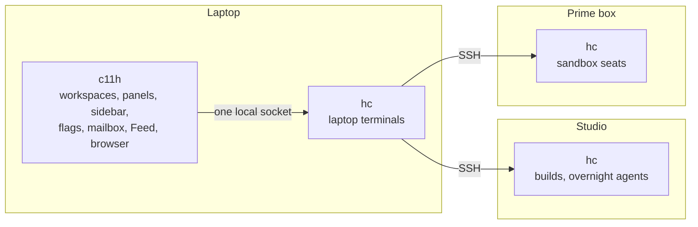

<!-- c11-2.0:begin-keep (history: written while this line was c11h; the rename must not touch it) -->
# c11h

Status: vision, 2026-10-31; graduated 2026-11-13. Owner: Atin. **c11h became c11 2.0 on 2026-11-13** (`C11.md`, Decisions 1-3): the goal and laws below hold for c11 2.0, except law 7 and Decided 13, which those decisions supersede. The 2.0 plan is `docs/c11-2.0-plan.md`. The canonical statement of what c11h is, what it is called, and how it gets built. Technical design on hc: `docs/c11v-herdr-core.md`. Evidence: c11-ops `notes/c11v-herdr-core/` (`EXPLORATION.md`, `SPIKE-0B.md`).

## The vision

**The goal: persistent sessions; one operator coordinating many machines and many, many agents; and an excellent, customizable display for seeing and managing those agents.**

- **Persistent.** Terminals and the agents in them keep running when the app quits, crashes or updates, and when the laptop closes. hc holds them, which is a large part of why the hc route is worth taking.
- **Many machines, many agents, one operator.** The laptop, the build host and Prime boxes in one window. An agent on any of them reports, flags and mails as if it sat beside the operator, and the window stays legible at hundreds of agents.
- **An excellent, customizable display.** c11's experience today (workspaces, the sidebar, the attention model, flags, Feed, browser and markdown panels) is the floor, not the ceiling. The operator shapes what the display shows and how attention reaches them.

c11h began as an experiment: a separate app built from c11's code, with hc underneath, while c11 stayed the operator's daily tool. It earned its place, and ships as c11 2.0.

## Laws

1. Sessions persist: quitting, crashing or updating c11h, or closing the laptop, ends no work.
2. One window holds every machine: a terminal or agent anywhere appears and behaves as a local one.
3. A remote agent is a full citizen: it reports, flags and mails exactly as a local one does.
4. The window stays fast and legible at hundreds of agents.
5. The operator shapes the display: what it shows, how it is laid out, and how attention reaches them.
6. hc runs the terminals; c11h is the operator's interface to them and to the agents in them.
7. c11 is untouched: c11h is a separate app until it graduates. *(Superseded 2026-11-13 by `C11.md` Decisions 1-3: it graduates as c11 2.0.)*
8. We run stock hc, built and signed by us from upstream's releases, and keep our changes outside it; a patch goes in only when nothing outside can do the job. We never ask anyone's permission.
9. Every milestone ends in something Atin uses, and in his call to continue or stop.
10. Everything is agent-drivable: CLI, socket, structured logs and a skill.

## The shape

c11h talks to one hc, on its own machine. That hc reaches the others over SSH, so a terminal on the build host arrives in c11h like a local one, marked with its host.

## What sets c11h apart

herdr-app, herdr's own client on hc, already shows terminals from every machine with the status agents report. c11h's difference is the agent layer: agents that talk back and coordinate.

| | herdr-app | c11h |
|---|---|---|
| Terminals from every machine in one window | Yes | Yes (M3) |
| Agent status | Only agents that report it (OSC 7501): working, blocked, done, idle | Reported status plus c11's hooks, wrappers and detection |
| Layout kept on each machine | Yes | Borrow it (M3 or M4) |
| Alerts | A sound and an in-window toast | Flags, Feed, macOS notifications, menu bar extra |
| Agents report back (descriptions, flags, CLI verbs, a skill) | No | Yes, from any machine (M6) |
| Agents coordinate (mailbox, delegates, lineage, Feed answers) | No | Yes |
| Memory (journal, conversation resume, prompt cache) | No | Yes |
| Browser and markdown panels, macOS-native, computer-use testable | No | Yes |
| Customizable display | JavaScript mods that can draw panes and the sidebar | Themes and settings today, grown natively from what Atin asks for (Decided 6) |

## Milestones

Numbered in the order they run. Each ends with Atin trying it and deciding.

| | Milestone | Done when | Stops the project if |
|---|---|---|---|
| **M1** | **Usable.** c11h on hc with the full agent layer, validated in build-host guests, ending in a signed staging build on the laptop beside c11 (`docs/c11-plan.md`). | Quit, force-quit, a killed hc core and an installed update each leave every terminal running; Claude shows working in the sidebar again within 10 s and still gets mail; Atin uses it for real work. | Shells lose TCC grants after a relaunch; hc's memory runs away under heavy output. |
| **M2** | Folded into M1 (2026-10-31). | | |
| **M3** | **the build host.** Build-host terminals in c11h on the laptop: hc on the build host linked over the tailnet, remote status from hc's events, and build-host agents talking back through a prototype relay while the laptop is awake. Phase 2 of the M1 run (`docs/c11-plan.md`). | A workspace mixes laptop and build-host terminals; the lid closes for an hour; it reopens live; a build-host agent raises a flag and mails a laptop agent. | Typing over the tailnet above 20 ms typical; reconnect loses terminals. |
| **M4** | **Daily driver.** Atin runs c11h for real work across the laptop and the build host, for weeks. | Atin prefers it for agent work that reaches the build host. | hc's holder crashes and takes every terminal with it, or lag under his real load, and neither shards nor a patch fix it affordably. |
| **M5** | **Own hc.** Stock hc, built and signed by us, bundled inside c11h.app, with no self-update and its own sessions, all from outside the binary. c11h spreads its terminals across several hc sessions (shards), so a holder loss or an output flood touches one shard. Upstream releases arrive through a contract check and a pin bump. Runs alongside M4. | One app, no separate hc install, an update that keeps every live screen, and a new upstream release adopted without merging anything. | |
| **M6** | **Remote agents.** An agent on any machine reports, flags and mails as if local, with the laptop closed, and the prototype relay is replaced or authenticated; each machine keeps its agents' state, so it holds while the laptop is closed. **The goal.** | The full c11 skill works from a build-host terminal. | |
| **M7** | **New boxes.** One command makes a Prime box a host with hc, skills and CLIs. | A new box is usable in one command. | |
| **M8** | **Graduation.** c11h's backend becomes a setting, then the default, in c11, and the c11h name retires; or c11h stays a separate app. **Decided 2026-11-13: c11h becomes c11 2.0 and the name retires** (`C11.md` Decisions 1-3; prep in `docs/c11-2.0-plan.md`). | Atin's call, after a release cycle. | |
| **M9** | **Other screens.** A phone or web viewer on the same hc. | A blocked build-host agent answered from the phone. | |

The fallback if M1 or M4 stops the project: build our own daemon around cmux-tui's terminal host (Step 0's recommendation in `docs/c11v-design.md`).

## Names

| Name | Means |
|---|---|
| **c11** | The shipping app. 1.x was unchanged by this project; **2.0** is this project's line under c11's name (`docs/c11-2.0-identity.md`). |
| **c11h** | This project and its app until 2026-11-13: c11 on hc. Now c11 2.0's lineage name; it survives as hidden aliases and in ticket ids (`C11H-<n>`). |
| **hc** | herdr-core: herdr's open terminal runtime (Apache-2.0, Rust). A core per machine, a holder that owns the processes, machines linked over SSH. |
| **our hc build** | Stock herdr-core from an upstream release, built, signed and pinned by Stage 11 per c11h build (Decided 12). Our tooling around it (build, signing, contract checks, the Constellation census) is open source in `Stage-11-Agentics/hc`. |
| **shard** | One of the several hc sessions c11h spreads its terminals across, each with its own core and holder (Decided 12). |
| **herdr** | The company, and its terminal multiplexer (the TUI, not built on hc). |
| **herdr-app** | herdr's desktop client on hc; the nearest competitor. |
| **Heeler** | A third-party phone client being ported to hc. |
| **remote status** | M3: status and foreground program for remote terminals, read from hc's events. Was "thin E". |
| **remote agents** | M6: the full agent layer from any machine. Was "thick E". |
| **c11d-remote** | c11's existing Go helper for `c11 ssh`; unrelated, keeps its name and its browser proxy. |
| Retired: **c11v** | The earlier project name, for a generic daemon plan (`docs/c11v-design.md`). The hc route replaces it; that doc stays for Step 0 results and the fallback. |
| Retired: **c11d** | The daemon we would have written. hc takes its place; it remains the fallback's name. |
| Retired: **steps 0 to 6, milestones A to H** | Superseded by M1 to M9. Step 0 and spike 0b are finished spikes. |

## Separation from c11

| | c11 | c11h |
|---|---|---|
| App | `c11.app`, `com.stage11.c11` | `c11h.app`, `com.stage11.c11h` |
| Socket, defaults, saved sessions, TCC grants | c11's | its own |
| hc | none | its own session, `c11h` |
| Dev builds and build-host tags | `c11 DEV <tag>` | `c11h DEV <tag>`, tag `c11h` |
| Tickets | hosted Lattice `stage11/c11` | hosted Lattice `stage11/c11h` |
| Code | `Stage-11-Agentics/c11` (public) | `Stage-11-Agentics/c11h` (private GitHub) in its own clone, c11's `main` merged in regularly; nothing lands in c11 before M8 |

Before c11h runs beside c11 on one machine, tooling that matches `c11` loosely is tightened (`scripts/rebuild.sh` runs `pkill -9 -f c11`).

In 2.0 this table collapses into c11's column: 2.0 takes `c11.app`, `com.stage11.c11`, c11's socket, defaults and state, and names its hc sessions `c11` and `c11-s1..s8`. A first launch adopts c11h's or c11 1.x's state (`docs/c11-2.0-identity.md` §0 and §3).

## Not doing

- Renaming or replacing c11 before M8.
- Shipping c11h to anyone but Atin before the plan's Milestone 5, its public release (Decided 15).
- Shipping the prototype relay (Decided 9): before c11h reaches anyone else, it gets real authentication or M6 replaces it.
- Depending on a user-installed hc, or sharing herdr's default session.
- Moving c11's agent state (metadata, flags, mailbox) into hc documents.
- Cloning herdr-app; c11h stays macOS-native.

## Decided

1. **2026-10-30.** Build on hc, in a fork that tracks upstream (Atin).
2. **2026-10-31.** The name is c11h, a separate app from c11 (Atin). *(Superseded 2026-11-13: c11 2.0, `C11.md` Decision 1.)*
3. **2026-10-31.** hc may live on the build host in its own folder and session, off PATH (Atin). Where M1 runs: see 7.
4. **2026-10-31.** Milestone order M1 to M9 as above; the fork starts when M4 needs a patch (Atin).
5. **2026-10-31.** Build c11h rather than adopt herdr-app. Atin tried herdr-app on the laptop with a terminal on the build host: "it's cool, but it's not quite right for me." herdr-app stays installed as a reference.
6. **2026-10-31.** "Customizable" is built natively in c11h on c11's own model, not through herdr-app or its mods. It starts with settings, themes and layouts that the operator and agents (through the CLI) can shape, and grows from what Atin asks for while using it, mainly in M4. Extensions written by the operator or agents wait until he names something settings can't do.
7. **2026-10-31.** M2 folds into M1, and M1 ends in a staging build Atin can use: "once Milestone 1 is done, am I going to be able to use this? Because that's really where I want to get to" (Atin). Validation in build-host guests, then the staging build on the laptop, signed with Stage 11's Developer ID (Atin confirmed).
8. **2026-10-31.** One forge and its own board: a private GitHub repo `Stage-11-Agentics/c11h` in its own folder, and the hosted Lattice project `stage11/c11h` (Atin).
9. **2026-10-31.** Build-host agents talk back to c11h on the laptop through a relay with prototype-grade trust, fixed before any release (Atin: "okay with lowering security for the purpose of this prototyping build ... long term we fix that before we release c11h to the world").
10. **2026-10-31.** Our hc fork ships open source under its own binary name. We never contact herdr's maintainer, open issues or pull requests there, or ask permission; the fork meets Apache-2.0's own terms itself (its LICENSE kept, changed files marked). Atin: "We yeet it out open source ... We don't contact maintainers and we don't ask permission."
11. **2026-10-31.** The agent layer's store and transport at M6 is one small open-source message core (envelope v1 plus ext, per-host logs that merge, mail with receipts), bundled by c11h on every host; Stage 11 runs the same core standalone as the Constellation bus, and hc stays out of the message path (Atin, 19:09, relayed by the Bus Lead; constellation-bus run-state D41, US-47, AC-182 to AC-186). Phase 2's relay is replaced by it at M6.
12. **2026-11-01.** Stock hc, changes outside it, and shards (Atin, 12:40 to 12:50, with the hc Lead: "we really want to be able to effortlessly pull Herder core updates ... maybe we make a shim so we literally use stock Herder core"; "I love what we're talking about regarding both hard shards and using stock HC ... consider this the new plan"). c11h runs unmodified upstream hc, built and signed by us; self-update, launch, config and logging are handled outside the binary; c11h spreads terminals across several hc sessions so a holder loss or a flood stays in one; a patch goes in only when nothing outside can do the job (today: a durable history clear and hc's own terminal-query answers, both accepted residuals). Amends 1, 4 and 10: the repo `Stage-11-Agentics/hc` (private GitHub, standalone, Atin 12:40) holds our build and tooling, and a patch branch only if one is ever needed. Plan: `~/src/hc/docs/fork-plan.md`.
13. *(Superseded 2026-11-13 by `C11.md` Decisions 1-3: c11h becomes c11 2.0.)* **2026-11-01.** c11h stays a separate app for now, and c11 and its users are not disturbed (Atin, 13:20: "keep C11H as a separate app for the time being as we keep pressing ahead. Eventually, we very well could graduate, but for now ... there's no advantage to pulling them in. I want our existing users to not be disrupted"). The priority is Atin running a fleet where local and remote hc terminals all work well inside c11h. Graduation (M8, Open 5) is deferred, not ruled out.
14. **2026-11-01.** The Constellation bus is off c11h's critical path (Atin, 13:35: "we don't want to wait. Bus is almost a separate project. I would love to keep that out of the critical path"). c11h builds its per-host agent layer now on envelope v1 and the bus agreements (plan ticket 14), with c11h's own link carrying mail between hosts; the bus core may replace that transport later. Amends 11: nothing in c11h waits on the bus.
15. **2026-11-01.** The plan's milestones after the fleet (`docs/c11-milestones.md` numbering, not the M-codes in the table above), in order: 3 **Your constellation** (more machines, and their mail moving to the Constellation bus), 4 **Hundreds**, 5 **Public release**, the lowest priority (Atin, 15:08 to 15:52: "yes, renumber the milestones ... Regarding release ... public release to the world, let's keep C11H a separate thing that just I'm using for the time being"). c11h is Atin's alone until Milestone 5, and it ships then as its own app. The bus's coding may start ("We can lift the no-coding yet line", 15:53). At 18:16: the bus is optional for Milestone 3 ("Bus is optional. No big deal on weak trust as it is temporary"), and Milestone 3's c11h work overlaps Milestone 2 from about 2026-11-03; no phone path ("completely out of scope"); no attention screen in these milestones, since Atin builds that primitive himself, with a Chief of Staff approach. Mail on the bus is sealed if that adds little (17:39 and 18:16). Plan: `docs/c11-milestones-3-5.md`. Amends 14. *(Amended 2026-11-13 by `C11.md` Decisions 1-3: it ships as c11 2.0, not as its own app, and public on Atin's go.)*

## Open

1. Where the code lives. Settled: Decided 8.
2. A workspace in c11 for the project's agents, named "c11h build" so it isn't mistaken for the app. Lean: yes; the Orchestrator opens it at launch (plan, Settled 15).
3. The name of our bundled hc build. Decide at M5; with stock hc (Decided 12) it may stay `herdr-core`, credited as upstream's.
4. When to contact herdr's maintainer. Settled: never (Decided 10).
5. Graduation into c11, or a separate app for good. Deferred: separate for now (Decided 13). Settled 2026-11-13: graduation, as c11 2.0 (`C11.md` Decision 1).
6. Whether the agent layer (mailbox, flags, metadata, journal, lineage) becomes its own per-machine system with c11h as its interface. Settled: Decided 11.
<!-- c11-2.0:end-keep -->
