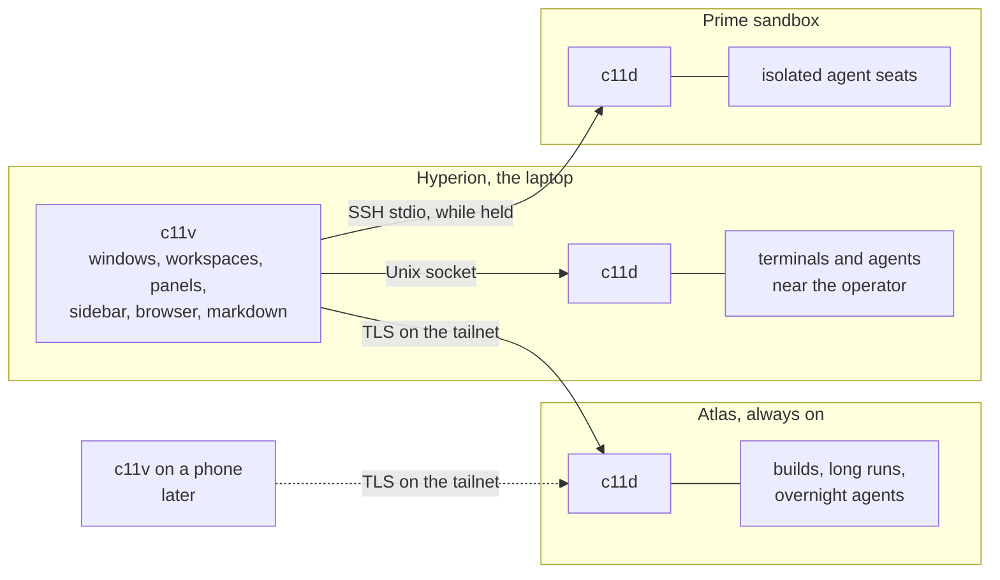
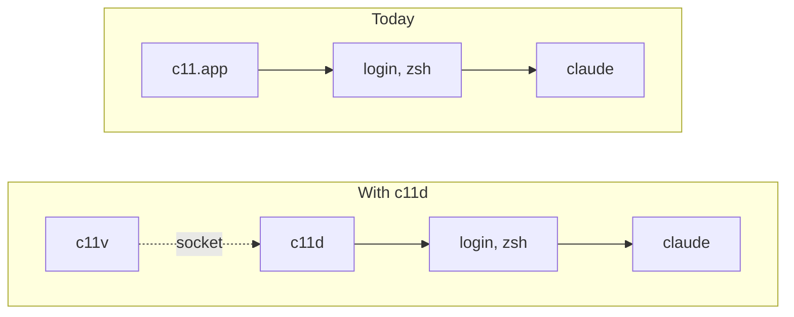
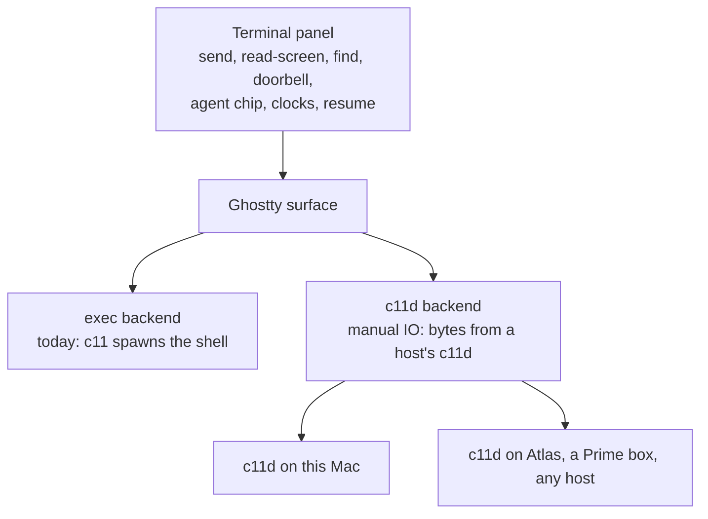
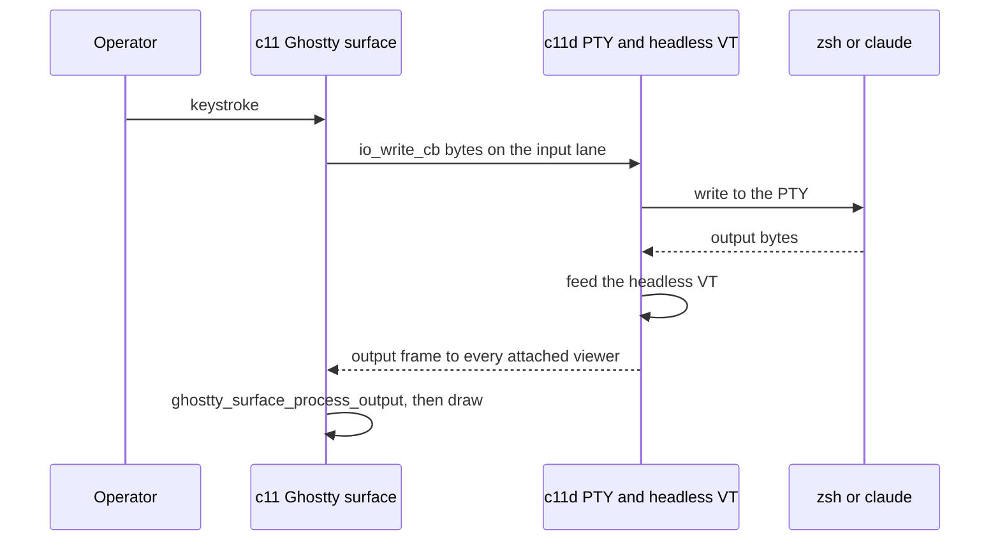
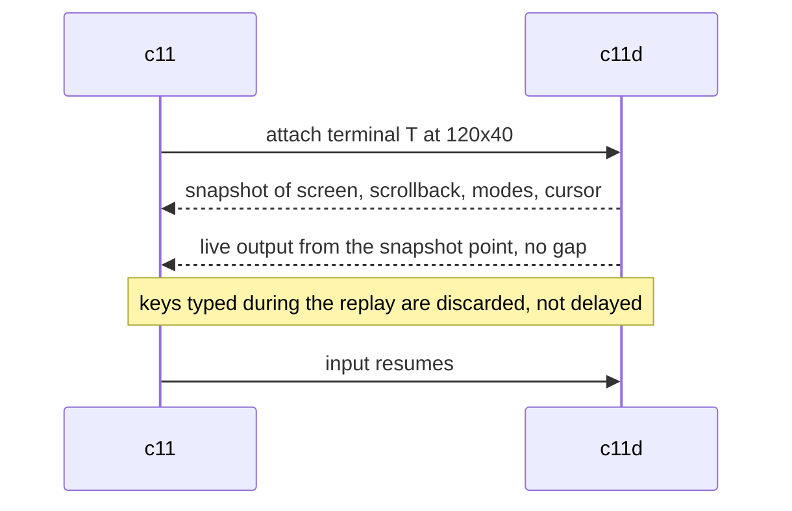
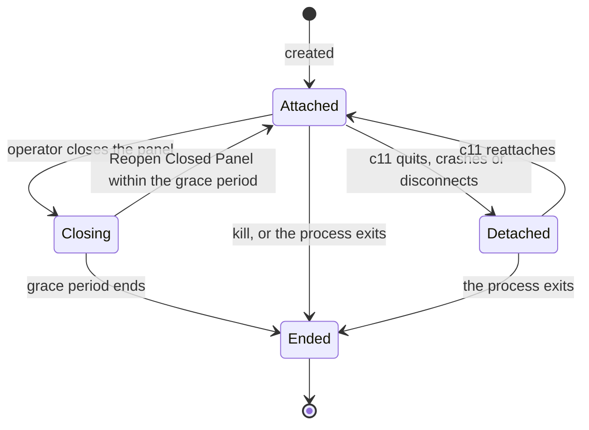
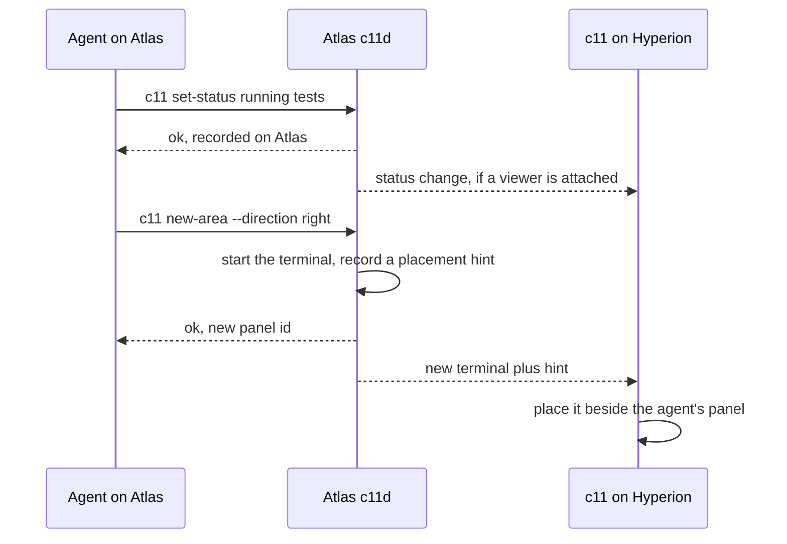

# c11v: terminals anywhere, one c11

Status: design draft, 2026-10-24; decisions 6 and 7 and the step 0 results added 2026-10-28; decision 8, the Prime transport correction and the session finder added 2026-10-30. Owner: Atin. Working project name: **c11v** ("c11 Plus" is the alternative).
Related: `docs/remote-daemon-spec.md` (today's `c11 ssh` and `c11d-remote`), `upstream-triage/c11-1.0/02-ssh-agents.md` (remote agent research), `upstream-triage/c11-1.0/04-ios-companion.md` (phone view).

## Decisions so far

1. **c11 stays c11.** No new app and no rename. c11v is the name of this project and of the role c11 grows into, not a product operators install.
2. **A daemon terminal is a terminal.** It is the existing terminal panel with a host, rendered by the existing Ghostty surface. Panel types stay terminal, browser and markdown.
3. **Every host runs `c11d`, including the operator's own machine**, and c11 reaches its local `c11d` the same way it reaches a remote one.
4. **Browsers are views.** Agents bring their own headless browsers on their own hosts; the c11 browser is the operator's display.
5. **c11 stays workable for its users at every step.** Hundreds of people use it daily. Everything here ships behind settings, falls back to today's path, and lands in small steps (see Keeping c11 workable).
6. **Remote hosts come before the local default.** Step 2 (opt-in remote terminals) ships before step 3 (daemon terminals by default), so the daemon is proven on work that opted in before it touches anyone's everyday terminal.
7. **The work starts as a spike, not a ticket.** Step 0 runs first with no ticket; tickets are cut from what it settles.
8. **Mail between hosts is Constellation Bus's job.** `c11d` never sends mail to another host. Each host's `c11d` is the bus's last mile there: the bus registers panel addresses with `c11d` over its socket and drops envelopes into the mailbox outbox, with its own fields under `ext.cbus`. The doorbell and composer checks stay in `c11d`. Without the bus, mail stays within each host and remote terminals still work. Why: Prime boxes accept no inbound connections, systems such as CI and the phone run no `c11d`, and c11 is public while the bus is Stage 11's private setup. (Atin, bus decision D39, 2026-10-29; bus criteria AC-79 to AC-81, AC-120 to AC-125, AC-176 to AC-178.)

## The idea

An operator's machines form a constellation: a laptop, an always-on desktop, cloud and sandbox boxes. Each kind of work has a best place to run. Editor-adjacent work belongs near the operator; long builds and overnight agents belong on the machine that never sleeps; risky or parallel seats belong in throwaway sandboxes.

c11v lets the operator run every terminal in its best place and steer all of them from **one c11**.

- **`c11d`, the daemon, is where work runs.** Every host runs one. It owns the terminals, the processes in them, their screens, and everything agents report about themselves. It keeps running whether or not anyone is looking.
- **c11, the viewer, is how a human sees and steers the work.** It owns windows, workspaces, areas, panels, the sidebar, attention, browser panels and markdown rendering. Once the project is done, it runs no terminal processes itself. In this doc **c11v** means c11 in that viewer role; a web or phone viewer would be another c11v.

A panel is **a view bound to a resource on a host**. A terminal panel shows a terminal on some host's `c11d`. A markdown panel shows a file on some host. A browser panel is a local display surface whose traffic can leave from a chosen host.



## Full separation, even on one machine

In the end state, c11 reaches the `c11d` on its own machine exactly as it reaches Atlas's: over the protocol, with only the transport different (a Unix socket instead of TLS). There is no in-process shortcut, no shared memory, and no special local path. The test of the rule is that the daemon path in c11 links no PTY code, spawns no processes, and would run correctly on a machine with no `c11d` at all, such as an iPad.

This costs one local socket hop per keystroke (budgeted under Costs and risks). It buys one code path, a viewer that can crash without consequence, and a daemon that a phone can use as readily as a laptop.



Today every agent is a descendant of the app, so anything that kills the app kills the fleet. With the split, the viewer has no children: force-quitting it ends nothing on the far side of the dotted socket link.

## What this buys

1. **The viewer can die without the fleet dying.** A hung main thread, a crash, a force-quit or a Sparkle update ends every terminal today. In the C11-186 incident a 14-hour main-thread deadlock had one remedy, and it killed 22 agents mid-run. With `c11d`, relaunching c11 reattaches every panel to the same live process with its exact screen.
2. **Work runs in its best place.** Agents on Atlas or a Prime box keep working with the laptop shut. Opening the lid reattaches.
3. **One model everywhere.** A remote terminal is an ordinary terminal with a host badge. Every c11 verb works on it, because the agent's CLI talks to its own host's `c11d`.
4. **New viewers are cheap.** Phone and web viewers are clients of the same protocol, not ports of the app.

## Inside c11: a terminal with a host

Nearly everything c11 does with terminals is wired to the terminal panel and its Ghostty surface: `send`, `read-screen`, the input guard, the find overlay, agent detection, the mailbox doorbell, conversation resume, and the panel sheet's clocks and model chip (`TerminalPanel` and `TerminalSurface` are special-cased about 190 times across `Sources/`). A daemon terminal and a local terminal differ in one place: where the bytes come from. So the change is a backend inside the terminal, not a new panel type, and everything above it works from the start.



c11's Ghostty fork already has the manual IO mode the second backend needs: `GHOSTTY_SURFACE_IO_MANUAL`, an `io_write_cb` for keystrokes, and `ghostty_surface_process_output` for output (`ghostty/include/ghostty.h`). Nothing in `Sources/` uses it yet.

What the operator sees:

```
┌ 12: impl ────────┬ 13: reviewer · atlas ┬ 14: docs ─────┐
│ terminal (here)  │ terminal on Atlas    │ markdown      │
```

- A terminal on another machine carries a host badge (`atlas`, `prime-3`) in its title, the panel sheet and `c11 tree`.
- **New Terminal On ▸ This Mac / Atlas / …** in the menu and command palette; `--host atlas` on `new-area`, `new-panel` and `launch-agent` for agents.
- A daemon terminal on this Mac looks exactly like today's terminal, except it survives c11 quitting or crashing.

What it deliberately is not: a panel that shows a whole remote machine, with its own workspaces and splits nested inside. That means two layout systems, confused keyboard focus, and an attention model that cannot see the agents inside it.

## Keeping c11 workable

These rules hold at every step.

1. **Today's path stays the default until the new one has earned it.** The exec backend is untouched code, not a rewrite. The daemon backend is additive, behind a setting that is off by default, until step 3.
2. **Nothing runs that the operator did not turn on.** `c11d` is registered with `SMAppService` only when the operator enables daemon terminals. Someone who never opts in never runs a daemon.
3. **Failure falls back, never strands.** If `c11d` is unreachable when a terminal is created, c11 creates an exec terminal and says so. A panel is never left dead waiting on a daemon.
4. **A kill switch.** Turning the setting off makes new terminals exec again. Running daemon terminals keep running until closed, and a menu item ends them all.
5. **Snapshots stay readable both ways.** A snapshot holding daemon terminals must restore in an older c11 as fresh shells, not as an error, so a downgrade is always safe.
6. **Small merges to `main`, behind the setting.** No long-lived branch. Each step lands as small PRs through the normal gates; the setting keeps unfinished work invisible.
7. **Atin's fleet first.** Each step runs on Atin's own machines and through nightly before a release carries it. Every release still needs Atin's named approval.

## What lives where

| State | Owner | Notes |
|---|---|---|
| Terminal process, PTY, foreground process group | `c11d` | Survives every viewer event |
| Screen, scrollback, modes, title, cwd | `c11d` | A headless VT per terminal; the viewer's Ghostty surface is a renderer replayed into |
| Creation lineage (`parent_panel_id`), agent identity, lifecycle, metadata, status, progress, log, flags, delegate state | `c11d` | Written by agents through their host's socket (step 4) |
| Mailbox, events stream, journal, conversation refs, session index, transcript scraping, prompt cache, model detection | `c11d` | Read where the transcripts live; c11 aggregates (step 4). Mail stays on its host; the bus carries it between hosts (decision 8) |
| Input guard and doorbell typing | `c11d` | It holds the screen model and the PTY, so composer reads and checked input happen next to the bytes |
| Windows, workspaces, folders, areas, split geometry, panel order | c11 | A workspace may hold terminals from several hosts |
| Focus, selection, seen time, focus history, attention routing, Feed | c11 | Per viewer; one viewer's focus never moves another's |
| Browser panels, markdown rendering, themes, settings | c11 | Markdown file reads and change notifications come from the file's host |

## Placement

Every terminal is created on one host and stays there. The host is chosen at creation: an explicit `--host`; otherwise the workspace's default host; otherwise the host of the panel that asked. Saved agent configs (`c11 config`) can carry a default host, so "a Codex reviewer" can always mean "on Atlas".

Agents compose their environment the same way. `c11 new-area` from an agent creates a terminal on its own host (or the one it names) and records a placement hint: beside panel P, direction, size. Any attached viewer applies the hint. With no viewer attached, the terminal runs anyway and is placed when a viewer next attaches.

## Architecture

### `c11d`

One process per host per c11 install, supervised: on macOS a LaunchAgent bundled inside the app and registered with `SMAppService` on opt-in (it appears in Login Items; nothing is hand-written into `~/Library/LaunchAgents`); on Linux a systemd user unit installed by `c11d install`. It serves a Unix socket (0600, peer uid checked) for local clients, and a network listener for remote viewers when enabled.

Tagged dev builds run their own `c11d` with their own socket and state directory, keyed by tag. A dev daemon never adopts a production daemon's terminals.

### The terminal path



Mux needs a relay process per pane (`mux-attach`) because stock libghostty only supports exec. c11 does not, so a pane costs one socket stream, not a process.

Data and control are separate. Terminal bytes travel as raw frames with no per-byte encoding; resize, exit, title and metadata changes travel on a control lane. Mux (`[u32 len][u8 lane][payload]`) and cmux-tui's terminal-host protocol both show the shape.

### Screen state and reattach

`c11d` runs a headless VT (`libghostty-vt`) for every terminal. On attach it sends a rendered snapshot of the screen and scrollback, then live output with no gap, then lets input through.



cmux fixed the discarded-input case for its SSH PTYs in #10624. Several viewers may attach to one terminal. The most recently focused viewer owns the PTY size; the others render at that size, letterboxed.

### Close, quit, kill, upgrade



- **Close a panel:** the terminal is detached and kept for a grace period (60 s default), then terminated. Reopen Closed Panel (⌘⇧T) within the period reattaches the same live process.
- **Quit c11:** every daemon terminal detaches and keeps running. A separate menu item, Quit and End All Terminals, does what Quit does today. Exec terminals end on Quit as they do now.
- **Kill:** an explicit action ends the process immediately and cannot be undone.
- **Crash, hang, force-quit:** the same as Quit. Relaunch restores layout from the snapshot and reattaches every daemon terminal by UUID.
- **App update:** Sparkle replaces the app; the running daemon is untouched. c11 speaks the daemon's protocol version and the previous one.
- **Daemon upgrade:** the old daemon hands its PTY file descriptors and serialized VT state to its successor over a Unix socket (`SCM_RIGHTS`), then exits. Processes never notice. Mux's `migrate.rs` and ix-console do this today.

### Agents and the CLI

From step 4, the `c11` CLI inside a daemon terminal talks to its host's `c11d`. `c11d` answers agent-owned verbs itself (`set-agent`, `set-metadata`, `set-description`, `rename-panel`, `set-status`, `set-progress`, `log`, flags, delegate, `mailbox`, `conversation`, `events`, `identify`, `read-screen`, `send` to its own terminals). Viewer verbs (create areas and panels, open browser or markdown panels, focus) become requests that attached viewers apply; they never block an agent waiting for a viewer. Until step 4, local daemon terminals keep using the app's socket exactly as exec terminals do.



Every call from inside a terminal is bound to that terminal by the socket's peer credentials and the terminal's session, so a host can only speak for its own terminals. The deny-by-default allowlist from `02-ssh-agents.md` applies to anything that crosses hosts.

Programmatic input gains a checked form, after mux's terminal-control API: a caller reads a snapshot (`generation`, `revision`, `input_revision`, foreground process group) and sends input that `c11d` rejects if any of them changed. `send` keeps its current guards and becomes atomic with the check, because the check and the write happen in one process under one lock.

Agent detection moves to `c11d`, which sees the PTY's real foreground process (today `AgentDetector` runs `ps -t` against local ttys and sees only `ssh` for remote tabs).

### Finding sessions across hosts

Each `c11d` keeps a read-only index of every agent transcript on its host, not only the sessions it launched: Claude Code (`~/.claude/projects`) and Codex sessions, with session id, harness, cwd, title, last active time, whether the session is live, and which terminal holds it. Transcripts stay on their host.

- `c11 conversation find [query]` combines the indexes of every connected host; `-a` runs a deep search on the transcript's own host.
- Picking a live session focuses its panel instead of resuming it a second time, because two processes resuming one session is a known hazard.
- Picking an idle session opens a daemon terminal on its host running the harness's resume command, as `c11 conversation resume` does today.
- A local-only version can ship before c11v, on today's conversation store plus a transcript scan (C11-518). Step 2 adds hosts; step 4 moves the index into `c11d`. Whether the local version ships first is Atin's call.

### Hosts and transport

- **Same machine:** Unix socket.
- **Another machine:** TLS over TCP on the tailnet. The host key is generated at install and pinned on first contact (trust on first use, like `known_hosts`); each viewer holds a client token whose digest the host authorizes. Tailnet addresses are stable across Wi-Fi and LTE changes, so a connection survives roaming without QUIC.
- **Fallback:** SSH stdio for hosts with no tailnet, reusing today's bootstrap: upload a release-pinned, SHA-verified `c11d`, run it, attach. Unlike today, the daemon it starts is persistent and outlives the SSH link.
- **Prime boxes:** they never join the tailnet. Their only inbound path is Prime's SSH gateway (a PTY; `-- cmd` works; no port forwarding), so a Prime host always uses the SSH stdio path and is reachable only while a viewer holds that link. Its `c11d` keeps running when the link drops, and the next link reattaches.

Viewers initiate connections to hosts. Hosts never dial a laptop or each other.

### Browsers and markdown

- **Agents use their own headless browsers** (Playwright, Chrome DevTools MCP, whatever they prefer), running on their own host. An agent on a Prime box tests a web app with the laptop shut. c11 does not host agent browsers.
- **The c11 browser panel is the operator's display.** c11-browser automation stays available while a panel is open, for showing the operator something or driving what the operator is looking at, but it is no longer the default tool for agent testing. The c11 and c11-browser skills change to say so when remote hosts ship.
- **Remote dev servers stay reachable.** A browser panel opened from a remote terminal routes through that host's `c11d` (the existing `proxy.*` stream RPC), so `localhost:3000` means the agent's localhost.
- **Markdown panels** read files from the file's host and live-reload from its change notifications.
- A later panel could mirror an agent's headless browser (a CDP screencast). It fits the model as a view of a work-layer resource. It is not planned.

## Today

| Piece | State |
|---|---|
| Local terminals | Ghostty exec mode, children of c11.app; die with it |
| Restart recovery | Layout snapshot plus conversation resume by wrapper; running processes are lost |
| `c11 ssh` terminal | A local `ssh -tt`; the remote process dies on link drop |
| `c11d-remote` (Go) | Runs over SSH stdio for the link's lifetime. Provides browser proxying and `session.*` size bookkeeping. **Owns no PTYs**, keeps no screen model |
| Remote `c11` commands | Disabled for security (`remote-daemon-spec.md` §3.5) |
| Manual IO in the Ghostty fork | Present, unused |
| Agent state (mailbox, events, journal, conversation store) | Files under the app's local state; no host field in conversation refs |

## Steps

Each step ships on its own, behind the rules in Keeping c11 workable.

| Step | Scope | Operators see | Done when |
|---|---|---|---|
| 0 Spike | Tagged build: one terminal on the manual IO backend fed by a stub local daemon. Latency, the manual-IO checklist, the TCC check, a separability read of cmux-tui's terminal host | Nothing | Build-or-adopt and language decided, with numbers. Ran 2026-10-28 (Step 0 results); the decisions wait on Atin |
| 1 Hidden backend | Real `c11d` on this Mac; the daemon backend behind an off-by-default setting. Reattach replay, close grace and reopen, Quit and End All, fd-handoff upgrade, `SMAppService` on opt-in, per-tag isolation, fallback to exec | Nothing unless they opt in | Force-quit c11 mid-run with 20 agents on Atin's machine; relaunch; every agent is still running with its exact screen |
| 2 Hosts | `c11d` on Atlas, Linux and Prime boxes; tailnet transport, and SSH stdio for Prime boxes and other hosts off the tailnet; host badges; New Terminal On; `--host` | Opt-in remote terminals beside local ones | A workspace mixes Hyperion and Atlas terminals; close the laptop for an hour; Atlas work continues; reopen and it is live. A Prime terminal survives its SSH link dropping and reattaches on the next link |
| 3 Default | New terminals use the daemon by default; exec stays as a fallback setting; existing terminals finish on exec | Terminals survive quits and crashes | A release cycle on the default with no regression reports that trace to it |
| 4 Agent state | CLI agent verbs answered by the host daemon; metadata, flags, mailbox, events, journal, conversation scraping, the session index and prompt cache per host; the mailbox acknowledges mail after it is handled, not when it is read, and keeps the outbox-file seam unchanged (bus AC-80); checked input; doorbell in the daemon | Remote agents get full sidebar status, flags and mail; `c11 conversation find` searches every connected host | The full c11 skill works from an Atlas terminal, and with c11 closed as far as agent-owned verbs go |
| 5 Provisioning | One command to create a Prime sandbox with `c11d`, skills, CLIs and dotfiles; other providers as plug-ins | A new box in one command | A new box is a usable host in one command |
| 6 More viewers | Web and phone viewers; several viewers on one host at once | Steer the fleet from a phone | A blocked agent on Atlas is answered from the phone |

## Step 0 results

Run 2026-10-28 as a spike, on the local branch `spike/c11v-manual-io` (never pushed or merged). The full reports, the stub daemon and the evidence are in `spike/c11v/` on that branch.

1. **Manual IO works end to end.** A tagged build ran its terminals on Ghostty's manual IO backend, with a separate Rust stub daemon owning each PTY, in an Atlas sandbox guest. Passed: typing and echo, `stty size` after a resize, title, OSC 7, mouse, kitty keyboard, OSC 52 write, query replies, child exit, the find overlay, splits, fallback to exec when the daemon is unreachable, and reattach to the same shell after both Quit and a kill. Not proven: IME and bell (the guest probes failed on an exec panel too) and OSC 52 read.
2. **The hop is cheap.** The daemon adds 8.6 µs at p50 and 16.6 µs at p99 to a single-byte input-to-echo round trip on Hyperion (50,000 samples, load 11.8), against the 1 ms budget. Bulk output is about 22% slower (150 against 190 MiB/s).
3. **One defect: full-screen programs after a resize.** Forwarding the size at once lets vim redraw onto Ghostty's old grid. A 40 ms debounce fixes the terminal state, but the frame stays stale until the next render trigger. Cause not isolated.
4. **Ghostty hooks step 1 needs in the fork:** a child-exit call (`ghostty_surface_child_exited`), a resize callback ordered with Ghostty's reflow, a starting working directory, the environment Exec builds, and splits that stop inheriting their parent's `io_*` fields.
5. **Threading rules.** `io_write_cb` runs on Ghostty's IO thread, sometimes under the renderer lock, and must never block or wait on main. Daemon output goes to `ghostty_surface_process_output` from a background thread, never from main.
6. **c11 assumptions that break.** The socket access gate admits only descendants of c11, so CLI calls from daemon shells fail after a restart. The tty and pid features (`TerminalPIDResolver`, `AgentDetector`, `PortScanner`, mailbox stdin) need the daemon to report tty, child pid and foreground process group. c11's scrollback restore must skip daemon terminals, or history shows twice. The Quit dialog's copy is wrong for them.
7. **Raw replay is not enough.** Replaying a raw output ring garbles cursor-addressed output, so the headless VT snapshot in this design is required.
8. **cmux-tui's terminal host separates.** A 178-line harness against `cmux-tui-core`'s public API, built on Atlas, survived its launcher's death, reattached from a new process with an exact screen, served two viewers, arbitrated a resize and reported the exit code. Each terminal gets its own host process (7.6 MB RSS in a debug build) that outlives the daemon, so a daemon upgrade needs no fd handoff. The protocol (CMTH v4) has been stable since 2026-08-04, and the host files have had no commits for three weeks. The host sits in a 176k-line crate with 155 dependencies, so adopting it means copying about 8k lines of host code plus about 14k of PTY and VT wrapper.
9. **c11's Ghostty fork has no headless VT API.** 77 of the 90 `ghostty_*` functions cmux's VT wrapper uses are missing. Upstream Ghostty has them and needs Zig 0.16. This holds on every path.
10. **Licenses.** cmux-tui is GPL-3.0-or-later per its LICENSE (its Cargo metadata says MIT); section 13 of both GPLv3 and AGPLv3 allows combining it into AGPL c11. Mux has no license grant, and its daemon forks Indexable code that is not public, so it is reference only. Agent detection can come from herdr (Apache-2.0).
11. **TCC moves to the daemon.** Confirmed on Hyperion: shells under a daemon started by launchd are attributed to the daemon's own code identity, keyed by path for a bare binary. `AssociatedBundleIdentifiers` does not change that. Untested: a daemon registered with `SMAppService`, which Apple says may attribute to the app.

**Recommendation, waiting on Atin:** build `c11d` in Rust around a forked copy of cmux-tui's terminal host that stays compatible with CMTH, and pin `c11d` to its own newer Ghostty until c11's fork catches up.

## Build, adopt, or both

Three bodies of work already solve parts of this.

1. **Upstream cmux-tui** (`manaflow-ai/cmux`, `cmux-tui/`, since 2026-07-09, about 2,800 commits). A Rust mux with a durable headless server, a separate durable PTY host and binary data plane (`spec/terminal-host.md`, with role and rights tokens), machines and remote sessions over SSH, several frontends with private VT mirrors, a session journal, and a written contract for a persistent Swift frontend (`spec/native-frontend.md`). Licensed GPL-3.0-or-later except `cmux-tui/relays/cloudflare-do/` (BUSL-1.1); c11 is AGPL-3.0. Upstream's own Mac app does not attach to it yet; its iOS cloud client does (`Packages/Shared/CmuxTerminalClient`).
   - Pro: our lineage ("pull freely"), heavily exercised, already solves multi-viewer sizing, reattach replay and journal restore.
   - Con: very large surface (TUI, web frontend, bindings, providers), a different tree (`session/workspace/screen/pane/tab`), agent hooks installed into tenant config (forbidden here), an npm-based install, and an upstream moving at roughly 100 PRs a day.
2. **Mux** (`indexable-inc/mux`). A small, clean daemon (about 5,000 lines of Rust): PTY manager, headless VT replay, fd-handoff upgrades, QUIC remote broker, checked input, 60-second close grace. The best reading material for the minimal version. Its workspace declares MIT, but the repo has no license file and `muxd` forks Indexable's ix-console, so treat it as reference only until the license is confirmed.
3. **c11's own Go `c11d-remote`.** Proven bootstrap, artifact trust and browser proxying. No PTYs or VT; adding `libghostty-vt` means cgo.

**Recommendation:** decide in step 0. If cmux-tui's terminal host separates cleanly from the rest of cmux-tui, adopt it as the PTY holder and build c11's agent layer and protocol on top. If it doesn't, build `c11d` in Rust: both mux and cmux-tui chose Rust with `libghostty-vt`, and either is a working reference for the hard parts. Keep `c11d-remote`'s bootstrap and proxy code either way.

## Costs and risks

1. **A hop on every keystroke.** Budget: no perceptible change, under 1 ms added at p99 on Hyperion. Step 0 measured 16.6 µs. The typing-latency rules in `CLAUDE.md` apply to the new path.
2. **Manual IO completeness.** Exec mode is what every Ghostty user exercises. Step 0 proved most of the checklist; resize in full-screen programs, IME, bell and OSC 52 read remain (Step 0 results 1 and 3).
3. **The daemon is the new single point of failure.** A `c11d` crash takes the host's terminals with it. It has to be small, boring and off the main-thread patterns that hurt the app.
4. **TCC moves.** Processes spawned by `c11d` have `c11d`, not the app, as their responsible process, so Full Disk Access, microphone, camera and Automation grants attach to it. The existing Full Disk Access flow (`FullDiskAccessProbe`) must run in the daemon, the daemon needs c11's usage-description strings, and each tagged build's daemon needs its own grant. Confirmed in step 0 for a launchd daemon; an `SMAppService` registration is still to test.
5. **Quit no longer means stop** for daemon terminals. Operators who opt in need the explicit menu item and a one-time note.
6. **Closed terminals and scrollback cost memory** until they expire. Bound the grace period and scrollback per terminal.

## Open questions

1. **Build or adopt?** Step 0 recommends a Rust `c11d` around a forked, CMTH-compatible copy of cmux-tui's terminal host (Step 0 results 8). Waiting on Atin.
2. **Where does a workspace's structure live once agents create panels with no viewer attached?** Lean: `c11d` records terminals, lineage and placement hints; c11 owns geometry and applies hints. Upstream's "frontend projections" are the heavier alternative.
3. **How does mail cross hosts?** Decided: Constellation Bus carries it, and `c11d` never sends mail to another host (decision 8).
4. **Remote transport:** TLS on the tailnet (lean) versus QUIC like mux. QUIC adds roaming the tailnet already gives us.
5. **Grace period default:** 60 s like mux, or longer for agents? Lean: 60 s, configurable.
6. **Multi-viewer size policy:** most recently focused viewer owns size (lean), or smallest wins as `c11d-remote` does today.
7. **Project name:** c11v or c11 Plus.
8. **Which Ghostty does `c11d` use for screen state?** c11's fork lacks the headless VT API. Lean: `c11d` pins a newer upstream Ghostty (Zig 0.16) now, and c11's renderer fork moves to the same commit later. Waiting on Atin.
9. **Is one host process per terminal acceptable?** About 7.6 MB each in a debug build, so roughly 1.5 GB at 200 terminals before scrollback. Lean: yes; measure a release build in step 1.

## Non-goals

- A new app, a rename, or a new panel type.
- A renderer rewrite. Ghostty in AppKit stays the terminal renderer.
- A general-purpose tmux replacement. `c11d` serves c11 viewers.
- Hosting agents' browsers.
- Writing tenant config on any host.

## References

- Mux: `docs/architecture.html`, `docs/terminal-control.md`, `docs/closed-tabs.md`, `crates/muxd/src/migrate.rs` in `indexable-inc/mux`.
- cmux-tui: `cmux-tui/README.md`, `spec/terminal-host.md`, `spec/native-frontend.md`, `docs/concepts.md`, `docs/remote.md` on `upstream/main`.
- cmux's Go persistent remote PTYs: #8438, #9111, #10327, #10624.
- C11-186 (cancelled 2026-10-14), part D "detachable sessions", and `notes/BUG-main-thread-deadlock-attachSurface.md`.
