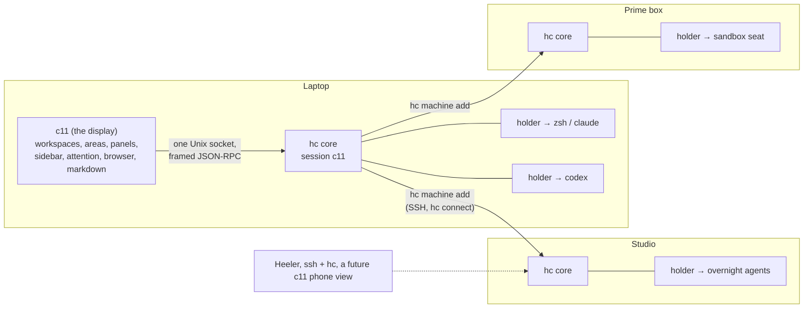

# c11v on herdr-core

Status: design sketch, 2026-10-30, corrected the same day from c11-ops `notes/c11v-herdr-core/EXPLORATION.md` (the corrections are listed there, section 10). Owner: Atin. The technical design under `docs/c11-vision.md` (the vision, names and milestones). Extends `docs/c11v-design.md`: it proposes herdr-core (`hc`) as the `c11d` of that design, the layer every c11 terminal runs on, while c11 stays the display: windows, workspaces, areas, and terminal, browser and markdown panels.

## The shape

- **hc runs every terminal.** One holder process per session (per core build) owns every PTY and keeps a 1 MiB raw tail per terminal; the core keeps each terminal's screen, one libghostty-vt instance per terminal. The core can crash, restart or update while programs keep running, and the holder restarts a crashed core by itself after 3 s; a crash leaves screens `inexact`, rebuilt from the tail. If the holder dies, every program in the session dies (`EXPLORATION.md`, issue 1).
- **c11 talks to one socket: its local core.** Remote hosts are machines that core added. Their terminals arrive in the same event stream as `studio/t7`, so c11 needs no transport code of its own. That is true for bytes. Line state is not in the event stream (poll `machine.list`), mirrored records go stale while a line is down, and a remote attach stream survives a drop by writing a banner into the terminal and repainting on reconnect.
- **c11 owns everything the operator sees**: layout, focus, panels, sidebar, attention, the browser and markdown rendering. It spawns no processes once the exec fallback retires.

## Verified 2026-10-30 (hc 0.1.14, the laptop, isolated session)

1. **Attach gives raw bytes.** After a rendered first paint (screen, optional scrollback, title, kitty key flags for each screen, modes), the stream is the program's own output. OSC 7, OSC 8 and 24-bit color SGR came through byte for byte. That is exactly what Ghostty's manual IO mode consumes.
2. **Latency is well inside budget.** A one-byte keystroke round trip to zsh's echo, through the core and a holder, measured p50 51 µs, p99 194 µs over 6,000 samples at load 7 (budget: 1 ms added). This includes zsh's own echo, so the added cost is lower. That is at idle: under an output flood from 8 terminals the round trip's p99 rose to 3.7 ms, 2.9 ms above a direct PTY in the same harness (`EXPLORATION.md`, issue 2).
3. **Processes outlive the core.** After `kill -9` on the core, the holder and shell kept running. The next `hc` call started a new core, which adopted the same shell (same pid). Its screen was rebuilt from the holder's 1 MiB tail and marked `inexact` (the core nudges full-screen programs with a resize so they repaint); only a planned restart restores an exact Ghostty snapshot. The holder also restarts a crashed core by itself.
4. **The VT is Ghostty.** Terminals report `ghostty 1.3.0-HEAD`. hc carries its own libghostty-vt, so the missing headless VT API in c11's fork (step 0 result 9) stops mattering: c11 renders with its fork and hc keeps the screen state.
5. **No telemetry in the core** (none found in `crates/herdr-core/src`). herdr-app does have telemetry.

## Mapping c11 onto hc

| c11 concept | On hc |
|---|---|
| Terminal panel | A Ghostty manual-IO surface bound to one hc terminal address (`t7`, `studio/t7`) through `terminal.attach` |
| Panel identity across restarts | Label `c11.panel=<uuid>` on the hc terminal; the snapshot records the address plus the machine |
| Host badge | The address's machine prefix |
| `new-area` / `new-panel` from an agent | `terminal.run` with labels for a placement hint (`c11.place=beside:<uuid>,right`). The terminal runs at once; any attached c11 places it, now or when it next attaches |
| `parent_panel_id`, lineage | Stays in c11. hc's `parent` ends children with their parent and types notes into reporting agents, and c11 lineage also spans browser and markdown panels; create hc terminals with `no_parent` and `no_notify` |
| Delegates, waiting for workers | c11 state, as today. hc's `wait --children`, notes and `send` to a parent are for agents that use hc directly; c11-created terminals carry `no_parent`, so they are not hc children |
| Lifecycle (working, idle, blocked) | OSC 7501 from the agent itself: Claude Code 2.1.314 reports it once the terminal answers its probe (verified in hc 2026-10-30); the wrappers cannot emit it, they `exec` the agent. Hooks stay the source for agents that do not report. Status then lives in the core, where herdr's own clients can see it too |
| Metadata, description, flags, delegate state | Stays in c11. hc documents are a poor fit: no list call, 1 MiB each, every write rewrites and fsyncs all documents under the lock typing takes, change events carry no value, and documents live on each core (not replicated). Labels are the hc channel for agent-reported fields from remote hosts |
| Agent detection | The record's `foreground {pid, name, argv, cwd}`, refreshed about twice a second, on every host. Ports, CPU and memory, and the doorbell's tty ownership checks stay kernel-local: they keep working for local terminals once c11 re-registers the tty after a restart, and have no remote equivalent |
| `read-screen`, input guard | `terminal.read` for hidden and remote `read-screen` (plain text). The composer check needs cell attributes and the cursor from the local surface, so the input guard and doorbell stay on c11's Ghostty; remote panels may use `terminal.send … if: idle` (turn-based) or fail closed |
| Markdown panels on a remote host | `file.read` with `on: studio`. Change notification is a gap: poll, or watch through `machine.exec` |
| Workspace layout | c11's snapshot as today, optionally mirrored to a document on a home host so another c11 can rebuild it |
| Scrollback for find | `history: N` on attach replays up to the core's 5 MB of main-screen history into Ghostty (not full scrollback); output since then accumulates in Ghostty |

## What c11 keeps, and what it stops doing

**Keeps.** All panel chrome, the sidebar and attention model, Feed, browser panels (WKWebView, the operator's display), markdown rendering, the mailbox, the journal, conversation resume, prompt cache and model detection, the skills.

**Stops.** Spawning shells, the `ps -t` process scan (its 10 s sweep also drives liveness decay, prompt-cache retention and model detection, which need a new timer), restoring its own scrollback for live hc terminals (keep one capture as the fallback for a lost holder), the "Quit ends everything" Quit dialog. The descendant-only socket gate becomes "env identity plus the peer descends from a live hc terminal's pid"; that restores attribution, not a security boundary, because hc has no per-client auth.

**Browsers.** Unchanged locally. A browser opened from a build-host terminal still needs egress through the build host; hc has no proxy. Keep `c11d-remote`'s `proxy.*` path over SSH, or open an SSH `-D` on the same connection hc uses. Agents bring their own headless browsers on their own host (c11v decision 4).

## Decisions to make

0. **Decided.** The direction, the name (c11), the milestones and the separation from c11 live in `docs/c11-vision.md`, which wins where this sketch differs.
1. **Bundle or depend.** Lean: ship a pinned hc build inside c11.app, signed by Stage 11 (Apache-2.0 allows it), run by c11 only after the operator opts in. Users never install it separately, and an update to herdr cannot restart c11's core. This needs a bundle mode in a Stage 11 fork: `hc update` swaps the running binary in place (it would break the bundle's seal, and a user's `hc update` typed inside a c11 terminal targets c11's core because terminals inherit `HC_SESSION`); upstream's macOS binaries are unsigned; there is no launchd integration.
2. **Own session or a shared one.** Lean: c11 uses its own hc session (`HC_SESSION=c11`), so it never collides with a herdr-app user's core. Sharing the default session is a later opt-in: c11 terminals would then show up in herdr-app and Heeler, and theirs in c11.
3. **Where agent state lives.** Lean, revised 2026-10-30: in c11, as today. hc documents are a poor fit (no list call, 1 MiB each, every write rewrites and fsyncs all documents under the lock typing takes, change events carry no value, no replication across machines). Labels on the hc terminal record are the channel for agent-reported fields from remote hosts. The mailbox stays in files under c11's own state.
4. **TCC.** Verified 2026-10-30: when c11.app spawns the core, the core, the holder, the core the holder later restarts, and every program and shell under them are attributed to c11.app (responsible pid), with no `SMAppService`. Untested: whether that holds after that c11 process quits and a new one launches (Step 0 case D suggests attribution persists by path). A launchd-started core is its own identity. Holders are setsid children of the core that spawned them and are reparented to launchd when it exits. This still needs the quit-and-relaunch test before step 1.
5. **Relationship with herdr.** herdr-app competes with c11 head-on. herdr is a YC F26 company with a $6M seed (2026-09); its core is one week old with one main author and a protocol marked preview (the growth-only test covers RPC params and results, not events, the framed wire or the holder protocol). The risks that matter are design, not head count: one holder per session and one parse thread under one lock (`EXPLORATION.md`, issues 1 and 2). The mitigations: the growth-only test (it covers RPC params and results against the last release, not events, the framed wire or the holder protocol), c11 talks to hc through one backend interface it could reimplement, and Apache-2.0 lets us fork. Whether to contact the maintainer, upstream fixes, or align on OSC 7501 is Atin's call.

## Spike 0b: what is left to prove

Ran 2026-10-30, 13:32 to 15:25 PDT, in a build-host guest: no kill criterion hit; 18 of 20 rows passed (bell and IME not drivable), the hc hop added 0.2 to 0.3 ms at p99 inside the app against a direct-PTY baseline, and vim after a resize was fixed on the c11 side. Report: c11-ops `notes/c11v-herdr-core/SPIKE-0B.md`; the list below is what it set out to prove.

The `spike/c11v-manual-io` branch already runs c11 terminals on manual IO against a Rust stub daemon. Point that backend at hc's attach stream instead, and run the step 0 checklist again:

1. Typing, resize, title, OSC 7, mouse, kitty keys, OSC 52, child exit, the find overlay over attached scrollback, splits, FOCUS and FACTS frames (c11's theme colors and cell size, resent on a light/dark switch), the mode-2048 in-band report right after each RESIZE, XTGETTCAP answered by c11's Ghostty, and a flood that triggers hc's 4 MiB repaint.
2. vim after a resize (step 0 result 3): hc leaves resize reports to viewers. Check whether its ordering fixes the stale frame.
3. Quit c11, `kill -9` c11: every panel reattaches with its exact screen. `kill -9` the core: every panel reattaches with an `inexact` screen rebuilt from the holder's tail, and full-screen programs repaint after the nudge.
4. A terminal on the build host through `hc machine add`, in the same workspace as local ones; close the laptop; reopen.
5. TCC with a bundled hc registered through `SMAppService`.

The Ghostty hooks from step 0 result 4 (child exit, resize ordering, start folder, environment, splits not inheriting `io_*`) are needed on any path.

## Sources

- herdr-core: `README.md`, `schema/README.md`, `schema/hc.openrpc.json`, `docs/security.md`, `docs/machines.md`, `crates/herdr-core/src/attach.rs` in `herdrdev/herdr-core`.
- herdr-app: `README.md` in `herdrdev/herdr-app`.
- `docs/c11v-design.md`, Step 0 results.
