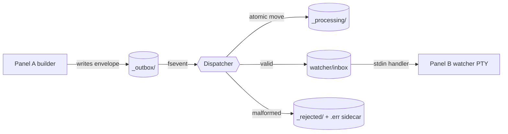
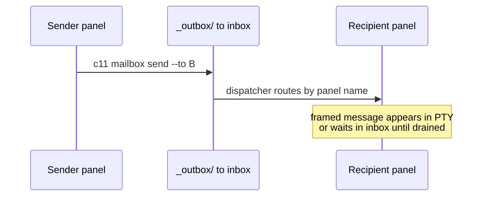
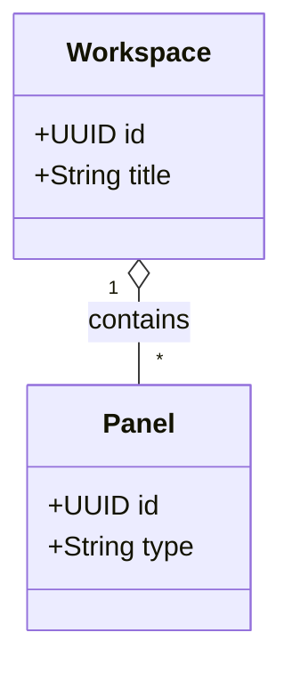
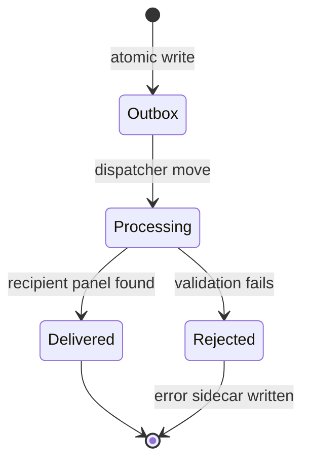
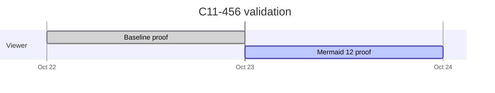
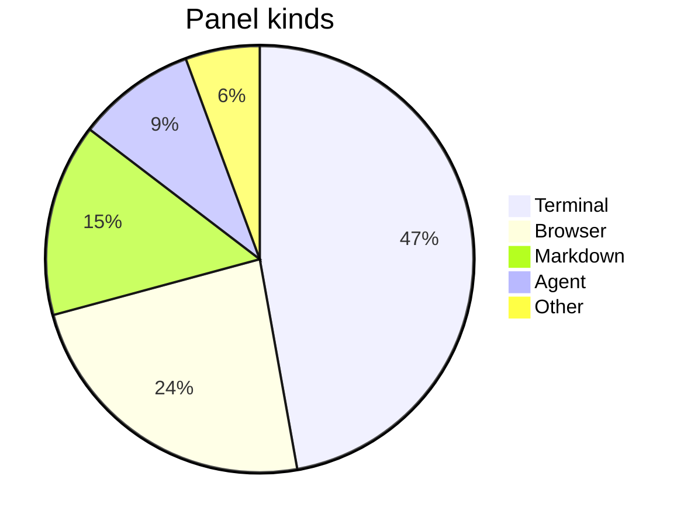
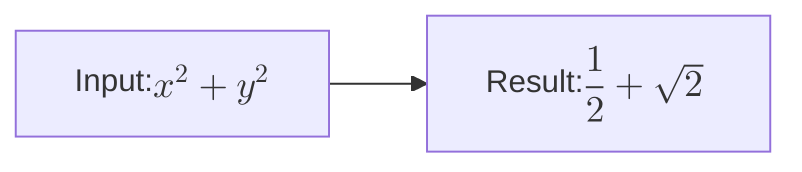

# Mermaid upgrade render matrix

This fixture exercises the diagram forms supported by the viewer and Mermaid math inside a label.

## Flowchart

## Sequence

## Class

## State

## Gantt

## Pie

## Math in a label

Mermaid math syntax uses double dollar delimiters.

