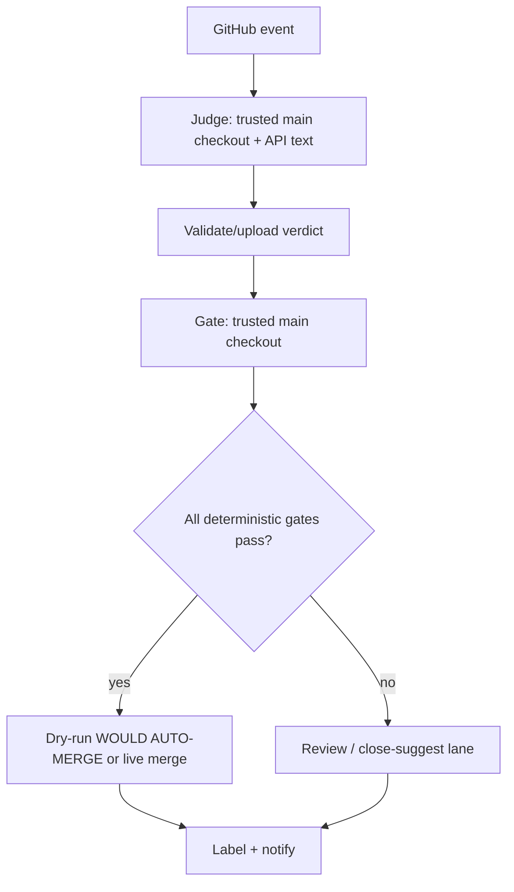

## Code Review
- **Date:** 2026-06-03T18:11:11Z
- **Model:** Codex (GPT-5)
- **Branch:** drawbridge-install
- **Latest Commit:** 36866f59617d9503798c7729b1f00bc7c610cf21
- **Linear Story:** drawbridge-install
---

## Validation

- `PYTHONDONTWRITEBYTECODE=1 python3 tests/drawbridge/test_gates.py`: PASS, 26/26 tests.
- `bash -n scripts/drawbridge/fetch-item.sh scripts/drawbridge/notify.sh scripts/drawbridge/upsert-comment.sh`: PASS.
- Ruby YAML parse for `.github/workflows/drawbridge.yml` and `.github/workflows/drawbridge-sweep.yml`: PASS.
- I did not run `npm run type-check`, `npm run lint`, or `npm test`; this branch adds GitHub Actions, shell scripts, Python gates, Markdown prompts, and policy docs, and the repo-specific validation path for the changed code is the Drawbridge Python/shell/YAML set above.
- I did not run Xcode suites; this branch touches no Swift code.
- I did not fetch/pull because the handoff explicitly restricts this pass to read-only review plus one output file, and fetch/pull would mutate repository refs or the worktree. The local committed branch state matches the provided review context: one commit over `origin/main`.

## General Feedback

This is a strong first installation of Drawbridge. The core architecture follows the spec's important security split: untrusted PR content is fetched as API text, the `pull_request_target` workflow checks out trusted `main`, the LLM judge does not directly perform repository actions, and the deterministic gate is implemented as plain Python with focused behavioral tests. The policy file is also doing the right job as the live/dry-run control surface.

The main correctness issue is in the workflow orchestration around CI discovery. The gate code correctly says that a code PR with zero non-Drawbridge check runs is not green, but the workflow can stop waiting before GitHub has even created those check runs. That makes eligible code bug fixes route to review by race, which undermines one of the explicit autonomous categories.

High-level flow:

## Findings

### Blockers

1. ✅ Confirmed: Eligible code PRs can be escalated before CI check runs exist.
   - **Files:** `.github/workflows/drawbridge.yml:211`, `.github/workflows/drawbridge.yml:216`, `.github/workflows/drawbridge.yml:217`, `scripts/drawbridge/gates.py:184`
   - **Why it matters:** In the eligible pre-pass path, the workflow polls `commits/{sha}/check-runs`, computes only `pending`, and breaks as soon as `pending == 0`. If GitHub has not created any non-Drawbridge check runs yet, `pending` is also zero, so the loop exits immediately. The final gate then sees `not runs` and, for code paths, fails with "no check runs and paths are not CI-ignored." That is fail-safe, but it means the intended autonomous bugfix lane can be lost to scheduler timing.
   - **Concrete fix:** During the wait loop, compute the non-Drawbridge check-run count as well as pending. For non-CI-ignored paths, keep waiting while the count is zero, then wait until all are completed. Alternatively, make the gate return an explicit `ci_pending_no_runs_yet` state and have the workflow continue polling until timeout. Add a workflow-level/unit simulation that covers "eligible code PR, first poll has zero check runs, later poll has green checks."

### Important

2. ✅ Confirmed: The workflow does not handle edited comments or updated issues, despite the Drawbridge spec covering comments opened or updated.
   - **File:** `.github/workflows/drawbridge.yml:25`, `.github/workflows/drawbridge.yml:27`
   - **Why it matters:** The spec says Drawbridge reacts to issue/PR/comment arrivals and updates. This workflow handles `issue_comment: [created]` only, and issues only on `opened`. If a contributor edits a comment to add new information, remove prompt-injection text, or substantially change the request, Drawbridge will not re-triage until the nightly sweep, and the sweep only finds unlabeled items. Already-labeled items with meaningful edits can stay stale.
   - **Concrete fix:** Add `edited` to `issue_comment` and consider `issues: [opened, edited, reopened]`, with dedupe/concurrency as already present. If the intent is deliberately "new only plus nightly unlabeled sweep," document that as a scoped deviation from the Drawbridge spec.

3. ✅ Confirmed: Localization can auto-route with zero validation because both CI and the Drawbridge CI gate ignore `Resources/Localizable.xcstrings`.
   - **Files:** `.github/workflows/ci.yml:11`, `.github/workflows/ci.yml:17`, `TRIAGE_POLICY.md:148`, `scripts/drawbridge/gates.py:184`, `tests/drawbridge/test_gates.py:246`
   - **Why it matters:** Org-member localization PRs are autonomous-eligible, and the test suite explicitly expects `Resources/Localizable.xcstrings` to route autonomous with zero check runs. A malformed `.xcstrings` file can break localization or build-time tooling while still passing Drawbridge's "CI green" gate because there is no CI signal to read.
   - **Concrete fix:** Either remove `Resources/Localizable.xcstrings` from the CI `paths-ignore` list, or add a deterministic localization validation gate before treating zero checks as acceptable. A cheap gate could parse the file as JSON/property-list data and assert the expected locale keys exist.

### Potential

4. ✅ Confirmed: The CI gate only considers check runs, not commit statuses.
   - **File:** `.github/workflows/drawbridge.yml:214`
   - **Why it matters:** This repo's primary CI appears to be GitHub Actions check runs, so this is probably acceptable today. If branch protection or future integrations add classic commit statuses, Drawbridge could declare CI green without considering them.
   - **Concrete fix:** If live mode will depend on repository branch protection semantics, query combined status or branch protection/required checks as well as check runs. If GitHub Actions is intentionally the only supported signal, document that assumption in `TRIAGE_POLICY.md`.

5. ✅ Confirmed: The nightly sweep never revisits already-labeled stale items.
   - **File:** `.github/workflows/drawbridge-sweep.yml:38`
   - **Why it matters:** The sweep is described as a recovery pass for missed event handlers. It filters out anything with a Drawbridge label, so it will not catch stale labels after new comments/edits, changed policy, or an interrupted post-label notification/review phase.
   - **Concrete fix:** Keep the current unlabeled sweep, but consider a second low-volume query for labeled items updated since the last Drawbridge run, or make event handling for edits complete enough that the sweep can remain strictly unlabeled.

## Summary

Do not merge as-is if the goal is a conforming Drawbridge install: the CI wait race should be fixed first because it can make the autonomous bugfix lane unreliable. The rest of the architecture is directionally sound and security-conscious; after the wait-loop fix, the remaining items are policy/coverage hardening before live mode.
