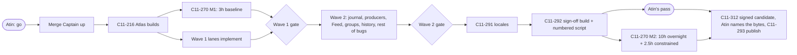

# c11 1.0 build flow

2026-10-01 evening. How the 57 `c11-1.0` tickets move from "planned" to a signed 1.0, once Atin says go. Sources: the board's dependency edges, every ticket's stored plan, Astra's whole-plan audit, `HANDOFF.md`.

## The shape in one picture

## Lanes: one owner per lane, tickets in order

Each lane is one live seat (14 total). A lane works its tickets one at a time, one branch and one PR each. Arrows are hard "merge before implement" dependencies.

| Lane | Owner | Ticket chain | Waits on (other lanes) |
|---|---|---|---|
| Atlas | Codex | **216** → 312 → 292 → 293 | 292 waits on every P0/P1 |
| Fixtures | Codex | 271 (PR #495, reviewed) → **263** | 263 waits on 271 |
| Soak | Codex | **270 M1** (3h baseline) … 270 M2 (end) | M1 after 216; M2 on the sign-off build |
| Journal | Astra | 273 | 263 (attention fixes), spec 272 done |
| Producers | Codex | 274, 275, 276 → 278 | 273; 278 after 274-276 + 231/277 |
| History | Codex | 262, 231, 277, 261, 291 | 231/277 after 273; 261 after 259+260; 291 after all English strings |
| Feed | Codex | 264 → 265 → 266 (→ 267 → 268, P2) | 264 after 263+273; 267/281 after C11-257 |
| Groups | Astra | 259 → 260 | perf proof needs M1 baseline |
| Ghostty | Astra | **294** (one submodule bump) | M1 baseline to measure against |
| Hangs | Astra | 296, 302, 303, 301, 295 | 302/295-B086 after 294; 301 serialized with 260 (ContentView) |
| Crashes | Astra | 299 → 297, 300, 298 | 297 after C11-257; 298 after 312 (signed proof) |
| CLI | Codex | **284** → 279 → 283 → 280 → 282 → 281 → 308 → 309 (→ 285, 286 P2) | 282 after 294; 281 after C11-257 |
| Launch | Codex | 306 → 258 → 269 → 305 (→ 311 P2) | 306 lands before 273/274 touch hook routing |
| Browser | Codex | 287 → 288, 290, 304, 307 (→ 289 P2) | 307 after 312 |

Bold = the lane's first ticket in wave 1. External dependency: **C11-257** (agent messaging, another run) must merge before C11-281, 267 and 297 land.

## Waves

**Wave 1, foundation (starts at go).**
1. Merge Captain launches. Early landings that need no Atlas build: PR #496 (skill short-prompt rule), C11-312 (signing workflow, CI only).
2. **C11-216** first: the first real tagged build on Atlas from a delegator worktree (Xcode 26.3). Everything that needs a build waits on it.
3. Then, in parallel: C11-270 **M1 baseline** (3h on Atlas, no other builds during it), and the wave-1 lanes implement: 294, 263, 284/279/283/280, 306/258/269/305, 299/297/300/296/303, 287/288/290/304, 259, 262. During M1, owners verify with GitHub CI (compile + logic tests, about 6-12 min per run), not Atlas.
4. C11-271 lands after its fixture test passes on Atlas.

**Gate 1:** M1 baseline published, fixtures replay on Atlas, Ghostty CI green with the new checksum.

**Wave 2, core.** 273 (journal store), then 274/275/276 producers, 231/277 consumers and analytics, 264 → 265 → 266 Feed; 260 groups sidebar, then 261 validation at 60 workspaces; 282, 295, 302, 301 after 294; 298, 307 after 312; the rest of the bug lanes.

**Gate 2:** one integrated build shows a bypass question or plan → your answer → resume → completion, independent unread completions, flag-plus-ask, suppression, sibling isolation, restart and exact-tab jumps, consistent across journal, `c11 agents --json`, Feed and the visible marks. Groups pass at 60 workspaces with no typing-latency regression against M1.

**Wave 3, sign-off.** English string freeze → 291 six-locale pass → 292 one integrated sign-off build plus your numbered script → your pass → 270 M2 (10h overnight, 40 agents, subscription logins) and the 2.5h constrained run → 312 produces the signed candidate → you name its hashes → 293 publishes those bytes.

**P2 (only if ahead; cut first):** 267, 268, 285, 286, 289, 311.

## How hard we can push

| Resource | Plan | Why |
|---|---|---|
| Owners implementing at once | 6 at go, up to 8-10 | Implementation runs on Hyperion and is API-bound (Codex is effectively unlimited); dependencies, not tokens, limit it |
| Reviewers | 1 per PR, in parallel | Cross-model within Codex; Grok and one Fable review allowed on large items |
| Merge Captain | 1, lands one PR at a time | `main` is unprotected, so CI on each PR head runs in parallel; the captain only serializes rebase + final check + merge |
| Atlas builds | **2 at a time** (Atin approved; drop to 1 if load stays above ~40) | Measured 2026-10-01: a cold Debug build takes 68 s alone; two at once finish in 106 s (vs 136 s back to back) at peak load 19 on 24 cores. Builds are not the bottleneck; reviews and the soak windows are |
| Soak windows | M1 3h, M2 10h + 2.5h | No other Atlas builds during them |

## Honest timeline

Optimistic, wall clock from go: C11-216 about 1-2h; M1 baseline 3h, overlapping wave-1 implementation; wave-1 landings and wave 2 about 8-12h, paced by review rounds and landing (builds are about a minute each); locale + sign-off build about 2h; then your pass, plus a 10h overnight M2 and 2.5h constrained run. **Roughly a day and a half to a signed 1.0**, not one night: the soak windows alone are 15.5h of serial Atlas time. Everything except the final soak can land in about one long day.
